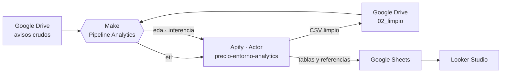

# Lüga

El [Colab integral con resultados ejecutados](notebooks/capstone_integral_colab.ipynb) incluye tablas, nueve figuras, conclusiones de los cinco modelos y el anexo de evaluación temporal. Se puede leer sin ejecutar ni subir datos. [Abrir en Google Colab](https://colab.research.google.com/github/montesquieu891/precio-entorno-caba/blob/main/notebooks/capstone_integral_colab.ipynb). Ver [modos de ejecución y guía](docs/colab-integral.md).

Prototipo local de búsqueda inmobiliaria. Una persona ingresa sus preferencias, compara barrios, guarda una búsqueda y recibe una alerta cuando aparece un aviso que coincide. Los delitos registrados se muestran como contexto y se analizan por separado para el capstone.

El [plan de entrega del capstone](docs/plan-capstone.md) reúne el cronograma de la profesora, las evidencias del repositorio y los pendientes para Analytics, Inference y la defensa comercial.

La [entrega de entrenamiento e inferencia del 18/11](docs/entrega-inferencia.md) documenta el ajuste de HistGradientBoosting, la comparación contra baseline, las métricas técnicas y de negocio, las predicciones en Streamlit y la estimación de costos. Incluye comandos para reproducir sin extracciones nuevas.

El [ANOVA de precios por barrio](docs/anova-barrios.md) compara medias de publicación con Welch y documenta supuestos, tamaño de efecto y comparaciones por pares con ajuste de Holm.

La [memoria matemática](docs/memoria-matematica.md) fundamenta los cinco modelos, sus transformaciones, la validación y el ANOVA. La [auditoría estadística](docs/auditoria-estadistica.md) identifica la comparación principal y sus diferencias con el prototipo operativo. La skill del proyecto está en `.agents/skills/auditoria-estadistica-capstone/`.

La [entrega de Producto 1 del 12/11](docs/entrega-12-11.md) incluye la auditoría de cumplimiento, muestras analíticas, diccionario, guion de demo y acciones de cierre por rol.

La [guía del flujo de trabajo](docs/flujo-de-trabajo.md) conecta la operación del producto con Analytics, Inference y el seguimiento en Trello.

El [trabajo por hacer (JTBD)](docs/jtbd.md) describe el progreso que busca quien se muda dentro de CABA, con sus dimensiones funcional, emocional y social, las alternativas que compiten por ese trabajo y qué falta validar. La [guía de entrevistas](docs/guia-entrevistas.md) tiene 12 preguntas sobre hechos pasados para confirmarlo. El [plan de design sprint](docs/sprint-confianza.md) prueba si la gente confía en la comparación con avisos parecidos que llega en la alerta.

El [plan de crecimiento](docs/plan-de-crecimiento.md) reúne la estrategia, los precios publicados, los costos y el plan semana a semana para la web, el negocio y las formas de cobrar.

## Flujo de datos: Make orquesta, Apify procesa



**Escenario de Make** «Precio y Entorno CABA - Pipeline Analytics»: 9 módulos, a pedido. Baja los avisos de Drive, llama tres veces al Actor de Apify (ETL, EDA e inferencia) y carga los resultados en la planilla que lee Looker Studio.


**Actor de Apify** `precio-entorno-analytics`:

| | |
| --- | --- |
| Qué es | Un solo Actor privado, en Python 3.13 con el SDK de Apify, que hace las tres etapas del análisis. Make lo llama por `run-sync` y recibe el resultado en la misma respuesta |
| Dónde | Cuenta 2 de Apify: `peerless_anorthite~precio-entorno-analytics` (ID `enW521Ne2ayG3JKZL`) |
| Código | [`precio_entorno/analytics/`](precio_entorno/analytics/) y su configuración en [`actores/analytics/.actor/`](actores/analytics/.actor/) |
| Entrada | `operacion` (`etl`, `eda` o `inferencia`) y el archivo en `contenidoBase64`. Los datos entran solo por la entrada, con el SDK: no descarga nada |
| Salida | `etl`: CSV limpio sin nulls. `eda`: seis tablas para Sheets. `inferencia`: referencia de publicación de cada aviso y la lista para revisar primero |
| Modelo | HistGradientBoosting ya entrenado, guardado en la carpeta del Actor (`modelo/`). El Actor no entrena: verifica la huella y la versión de scikit-learn, y predice |
| Delitos | Resumen por barrio del Mapa del Delito 2025, también en su carpeta (`referencias/`), armado desde el archivo oficial verificado |
| Costo | Prueba del 23/11/2026: ETL, EDA e inferencia, unos USD 0,0055 las tres corridas. Detalle de la inferencia en [Costo de una corrida de inferencia](#costo-de-una-corrida-de-inferencia) |
| Cómo correrlo | `python -m precio_entorno.apify_analytics subir --account 2` lo sube y construye; `probar` corre las tres etapas como Make. En Make: **Run once** en el escenario |

El detalle de cada módulo, el código del Actor y cómo publicarlo están en [Pipeline Analytics con Make, Apify y Looker Studio](#pipeline-analytics-con-make-apify-y-looker-studio) y en [docs/pipeline-analytics.md](docs/pipeline-analytics.md).

## Estructura del repositorio

```text
precio-entorno-caba/
├── actores/analytics/.actor/      # Actor de Apify: actor.json, input_schema.json, Dockerfile, requirements.txt
├── precio_entorno/                # Paquete de Python
│   ├── analytics/                 # Código del Actor: main.py, ETL.py, preprocessing.py, EDA.py,
│   │                              #   inference.py, tooling_business.py
│   ├── inferencia.py              # Entrenamiento del modelo operativo (no entra al Actor)
│   ├── benchmark_inmobiliario.py  # Comparación de cinco familias de modelos
│   ├── apify_analytics.py         # Sube, construye y prueba el Actor
│   ├── make_pipeline.py           # Crea o actualiza el escenario de Make
│   ├── api.py                     # Servidor de la interfaz web
│   └── ...                        # Importación, alertas, entorno, radar, ANOVA
├── .actor/                        # Actor de alertas: captura de inmobiliarias autorizadas
├── web/                           # Interfaz web con el mapa (HTML, JS y CSS)
├── app.py                         # App de Streamlit para importar datos y probar la actualización
├── notebooks/                     # Colab integral, benchmark y EDA
├── data/
│   ├── fixtures/                  # Datos ficticios para las pruebas
│   ├── raw/                       # Capturas autorizadas y Mapa del Delito (fuera de Git)
│   └── processed/                 # Salidas, modelo entrenado y capas del mapa (fuera de Git)
├── docs/                          # Metodología, entregas, negocio y capturas (docs/img/)
├── reports/                       # Resultados del benchmark y de la validación temporal
├── scripts/                       # Tareas programadas, Colab y despliegue
└── tests/                         # 308 pruebas: python -m unittest discover -s tests -v
```

## Funciones del pipeline

| Etapa | Función | Entrada | Salida | Qué hace |
| --- | --- | --- | --- | --- |
| Entrada | [`preprocessing.read_input`](precio_entorno/analytics/preprocessing.py) | Entrada del Actor | Operación y archivo en bytes | Valida la operación y decodifica `contenidoBase64`. Rechaza cualquier otra fuente |
| ETL | [`ETL.etl`](precio_entorno/analytics/ETL.py) | Avisos crudos (JSON o CSV) y delitos por barrio | CSV limpio (25 columnas, sin nulls) y reporte de calidad | Valida avisos, deja la captura más reciente, marca posibles duplicados entre fuentes, imputa y marca nulls, suma delitos por barrio |
| ETL | [`ETL.crimes_summary`](precio_entorno/analytics/ETL.py) | `delitos_2025.csv` oficial | Resumen por barrio (JSON) | Corre fuera del Actor al subirlo: totales por barrio y SHA-256 del archivo |
| EDA | [`EDA.eda`](precio_entorno/analytics/EDA.py) | CSV limpio | Seis tablas | Resumen, barrios, ambientes, fuentes, distribución y correlaciones para el dashboard |
| Preprocessing | [`preprocessing.model_frame`](precio_entorno/analytics/preprocessing.py) | CSV limpio | Avisos en USD con los nombres del modelo | Renombra, deja solo venta en USD y devuelve como faltantes las imputaciones del dashboard. No ajusta nada |
| Inferencia | [`inference.load`](precio_entorno/analytics/inference.py) | Carpeta `modelo/` del Actor | Modelo listo para predecir | Verifica SHA-256 y versión de scikit-learn antes de cargar |
| Inferencia | [`inference.predict_clean`](precio_entorno/analytics/inference.py) | CSV limpio y modelo | Referencia por aviso | Una sola pasada por el pipeline guardado: referencia en USD/m² y en USD |
| Negocio | [`tooling_business.compare_with_reference`](precio_entorno/analytics/tooling_business.py) | Avisos y referencias | Tabla ordenada con lectura | Diferencia % y lectura (debajo, cerca o encima, con umbral de ±20 %) |
| Negocio | [`tooling_business.to_review`](precio_entorno/analytics/tooling_business.py) | Tabla con lectura | Lista para revisar primero | Los avisos debajo de la referencia, del más bajo al menos |
| Salida | [`tooling_business.sheets_body`](precio_entorno/analytics/tooling_business.py) y `predictions_body` | Tablas | Cuerpo de `values:batchUpdate` | Lo que Make escribe en Google Sheets |

**Modelo seleccionado: HistGradientBoosting.** Se compararon cinco familias con validación anidada por grupos sobre 3.806 avisos de 48 barrios ([memoria matemática](docs/memoria-matematica.md), [resultados auditados](reports/benchmark-auditado/resultados.md)):

| Modelo | MAE (USD/m²) | R² | MdAPE |
| --- | ---: | ---: | ---: |
| **HistGradientBoosting** | **402,6** | **0,736** | **11,8 %** |
| Random Forest | 418,3 | 0,706 | 12,1 % |
| MLP | 443,9 | 0,696 | 13,1 % |
| KNN | 467,7 | 0,614 | 13,1 % |
| Ridge | 524,5 | 0,521 | 15,5 % |
| Mediana de comparables (referencia) | 585,6 | 0,407 | 17,1 % |

Por qué: tuvo el menor error en las tres métricas, maneja de forma nativa los faltantes y las categorías (barrio, inmobiliaria), y entrena en segundos. Random Forest quedó cerca, con más error y casi el doble de tiempo por pliegue (12,2 s contra 6,9 s); MLP y KNN tuvieron más error; Ridge, lineal, no capta las interacciones entre superficie, ubicación y barrio. El modelo que usa el Actor es un HGB operativo (pérdida absoluta, 300 iteraciones, tasa 0,05, 21 variables numéricas y 2 categóricas), entrenado fuera del Actor con `python -m precio_entorno.inferencia entrenar`.

## Contrato del actor de inferencia

Entrada (`operacion: "inferencia"`):

| Campo | Dirección | Tipo | Descripción |
| --- | --- | --- | --- |
| `operacion` | entrada | string | `"inferencia"` (también acepta `etl` y `eda`) |
| `contenidoBase64` | entrada | string (base64) | CSV limpio del ETL. Columnas obligatorias: `id`, `barrio`, `superficie_cubierta_m2`, `ambientes`. Usa `moneda`, `latitud`, `longitud`, `superficie_total_m2` y `fuente` si vienen. Solo entra venta en USD |

Salida (una fila por aviso en `OUTPUT` y `predicciones.csv`; el dataset guarda solo los que conviene revisar primero):

| Campo | Dirección | Tipo | Descripción |
| --- | --- | --- | --- |
| `id`, `barrio`, `ambientes`, `superficie_cubierta_m2`, `precio`, `precio_m2_usd`, `url` | salida | string / número | Datos del aviso, tal como llegaron |
| `referencia_publicacion_usd_m2` | salida | float | Referencia de publicación del modelo, en USD/m² |
| `referencia_publicacion_usd` | salida | float | La misma referencia por la superficie cubierta, en USD |
| `diferencia_pct` | salida | float | USD/m² publicado frente a la referencia, en % |
| `lectura` | salida | string | `debajo de la referencia` (−20 % o menos), `cerca`, `encima` (+20 % o más) o `sin lectura` |
| `barrio_no_visto` | salida | bool | El barrio no estaba en el entrenamiento: no se da lectura |
| `variables_numericas_faltantes` | salida | int | Cuántas de las 21 variables numéricas faltaron en el aviso |
| `modelo_version`, `fecha_prediccion_utc` | salida | string | Versión del modelo (`1d4013afcf906e8c`) y momento de la predicción |

Además, `RESUMEN_INFERENCIA` trae los conteos por lectura y el error que aplica al lote. La referencia es un precio de publicación esperado para inmuebles parecidos, no una tasación ni un precio de cierre.

## Métricas

**Del modelo (medidas).** Es un modelo de **regresión**: estima USD/m², así que se mide con error en USD/m² y R², no con accuracy.

| Métrica | Valor | Qué significa |
| --- | ---: | --- |
| MAE (métrica principal) | 402,6 USD/m² | Error medio absoluto del mejor modelo del benchmark |
| R² | 0,736 | Explica el 74 % de la variación de precios |
| Mejora frente a la mediana de comparables | −31,2 % | 585,6 → 402,6 USD/m² |
| Modelo operativo del Actor, prueba 80/20 | MAE 442,7 · R² 0,689 · 70,2 % dentro de ±20 % | El artefacto que corre en Apify |
| Avisos posteriores al entrenamiento (13 al 20/11) | MAE 528,7, un 9 % mejor que comparables | [Validación temporal](docs/entrega-inferencia.md#validación-temporal--20112026): el R² baja por la menor dispersión de esa muestra |

**De negocio (definidas, todavía no medidas).**

| Cliente | Métrica principal | Umbral | Dónde |
| --- | --- | --- | --- |
| Persona que busca departamento | % de quienes reciben el correo gratis y pagan | 5 de 20 (≥ 25 %) en 7 días | [Experimento concierge](docs/experimento-concierge.md) |
| Inmobiliaria | Minutos netos ahorrados por revisión frente a su método | ≥ 5 min (cubre una cuota de USD 39; con 10 min, ROI del 105 %) | [Pricing](docs/pricing.md), [validación](docs/validacion-inmobiliaria.md) |

Lo que ya se mide del lado del producto: la inferencia deja 566 de 3.806 avisos (14,9 %) para revisar primero.

## Costo de una corrida de inferencia

Corrida del 23/11/2026 en Apify sobre 3.806 avisos (`6hw5tjj51UHfgm5Wg`):

| | |
| --- | --- |
| Tiempo | 7,6 s de ejecución; 11 s de punta a punta con `run-sync` |
| Memoria y CPU | 1.024 MB asignados (≈ 0,25 vCPU en Apify), 151 MB de pico. Sin GPU |
| Unidades de cómputo | 0,0021 CU |
| Costo en Apify | USD 0,0035 por corrida, con el guardado del dataset y los registros |
| Costo por 1.000 avisos | ≈ USD 0,001 |
| Costo del pipeline completo | ETL + EDA + inferencia ≈ USD 0,0055 por corrida; Make usa 9 operaciones de las 1.000 mensuales del plan Free |

No incluye el entrenamiento, que se hace fuera del Actor (28,6 s en un equipo local), ni nuevas extracciones de avisos.

## Ejecutar en Windows

Desde la carpeta `precio-entorno-caba`, en PowerShell:

```powershell
python -m venv .venv
.\.venv\Scripts\python.exe -m pip install -r requirements.txt
.\.venv\Scripts\python.exe -m streamlit run app.py
```

Abrir la dirección local que indique Streamlit. Se usa para importar datos autorizados y probar la actualización.

### Interfaz web

La interfaz para quien busca departamento es una página propia, con la lista de barrios a la izquierda y el mapa de CABA a la derecha. Usa las mismas bases que Streamlit, que queda para importar datos y probar la actualización.

```powershell
.\.venv\Scripts\python.exe -m precio_entorno.api
```

Abrí http://127.0.0.1:8000. La API corre solo en la computadora local y su documentación está en http://127.0.0.1:8000/api/docs. El mapa necesita las capas de `data/processed/entorno/`, que se generan con `python -m precio_entorno.entorno`.

- **Filtros:** la barra de arriba elige comprar o alquilar, el presupuesto, la superficie, los ambientes y lo que te importa del entorno. Los cambios se aplican al escribir.
- **Mapa de la ciudad:** cada barrio tiene un tono según cuántos avisos encajan. Al pasar el cursor por un barrio en la lista, se resalta en el mapa, y al revés.
- **Ficha del barrio:** al elegir un barrio, el mapa se acerca y la lista pasa a ser su ficha, con el entorno, los avisos que encajan y el botón **Crear alerta**. Los botones sobre el mapa encienden y apagan cada capa.
- **Registros cerca del aviso:** en datos reales, **Ver registros cerca** abre radios de 250, 500 y 1.000 m para avisos con pin preciso. Se separan robos y hurtos, día y noche, con comparación anual y persistencia. Se usan los CSV anuales oficiales locales y se muestra la advertencia de revisión del informe ejecutivo de 2025. Ver [metodología y límites](docs/mapa-registros.md).
- **Celular:** el mapa ocupa la pantalla y la lista sube desde abajo.

El diseño está descripto en [docs/ui.md](docs/ui.md).

## Importar archivos autorizados

1. Abrí **Datos reales**. Esta opción usa `data/local/real.sqlite3`.
2. En **Importá datos locales**, indicá el nombre de un único catálogo autorizado, seleccioná el CSV o JSON de departamentos vigentes en venta y confirmá el acceso. Revisá las filas incorporadas, duplicadas y descartadas, y los faltantes e inválidos por campo.
3. Compará barrios con tus filtros, elegí uno y guardá la búsqueda. Importá un lote posterior del mismo catálogo. Cada ID nuevo compatible genera una alerta por búsqueda. Volver a importar ese ID conserva la primera observación y la alerta existente. Los lotes agregan avisos al historial local. La app aún no actualiza precios ni da de baja avisos ausentes de una captura posterior.
4. Cargá el CSV oficial del [Mapa del Delito de CABA](https://data.buenosaires.gob.ar/dataset/delitos). Cada archivo válido reemplaza el contexto anterior y queda identificado por nombre y SHA-256. Elegí barrio y mes para ver los hechos registrados por tipo y franja. La suma usa la columna de cantidad. Solo se muestra cero si hay filas válidas que lo respaldan. Un barrio y mes sin filas válidas figura sin cobertura observada.

### Formato del catálogo

El CSV lleva encabezados y admite coma, punto y coma o tabulación. Para decimales, usá punto o coma sin separador de miles. En un CSV separado por comas, entrecomillá los decimales escritos con coma. El JSON en UTF-8 admite una lista de objetos o un objeto con una lista `listings`.

| Campo requerido | Alias admitidos | Validación |
| --- | --- | --- |
| `listing_id` | `id` | Identificador estable dentro del catálogo |
| `url` | `enlace` | Enlace HTTP o HTTPS sin credenciales |
| `captured_at` | `fecha_captura` | Fecha o fecha y hora ISO 8601 |
| `price` | `precio` | Importe publicado entre USD 10.000 y 10.000.000 |
| `currency` | `moneda` | USD, U$S o US$ |
| `covered_area_m2` | `covered_area`, `superficie_cubierta` | Superficie cubierta entre 10 y 2.000 m² |
| `rooms` | `ambientes` | Entero entre 1 y 20 |
| `neighborhood` | `barrio` | Barrio de CABA |

Además, el precio por m² cubierto debe quedar entre USD 200 y 20.000. Un importe escrito con separador de miles, como `105.000`, se lee como 105 y se descarta por inválido. Los campos opcionales son `total_area_m2` (`superficie_total`, entre 10 y 10.000 m²), `latitude` (`latitud`, `lat`), `longitude` (`longitud`, `lon`) y `location_accuracy_m` (`precision_m`). Si incluís `source` o `fuente`, debe coincidir con el catálogo indicado. Prepará el archivo solo con departamentos residenciales en venta. La app cuenta un pin como utilizable si ambas coordenadas caen en el rectángulo aproximado de CABA y el catálogo declara una precisión de hasta 100 m. En esta etapa el cruce se hace por barrio.

El cargador de delitos admite encabezados como `id-mapa`, `fecha`, `barrio`, `tipo_delito`, `franja_horaria` y `cantidad`, y sus variantes `id_mapa`, `tipo`, `franja` y `cantidad_registrada`. Conserva la fecha del hecho y muestra las franjas faltantes como «Sin dato». El resumen corresponde a las filas válidas del archivo cargado.

Los archivos `data/fixtures/avisos_prueba.csv` y `data/fixtures/delitos_prueba.csv` son ficticios. Las pruebas los cargan en bases temporales. Si querés probar el formulario con esos archivos, usá una copia de la carpeta del proyecto para mantener la base real reservada al catálogo autorizado.

## Comprar o alquilar

Al entrar, la app pregunta **¿Qué querés hacer?: Comprar o Alquilar**. Cada operación tiene su propio catálogo, su base, sus búsquedas y sus alertas:

| Operación | Catálogo | Base real | Precio |
| --- | --- | --- | --- |
| Comprar | `inmobiliarias-autorizadas` | `data/local/real.sqlite3` | Precio publicado en USD |
| Alquilar | `inmobiliarias-alquiler` | `data/local/real-alquiler.sqlite3` | Alquiler mensual publicado en ARS o en USD, sin expensas |

- **Moneda:** en alquiler se elige la moneda de la búsqueda. La comparación y las alertas usan solo los avisos publicados en esa moneda, sin convertir pesos a dólares.
- **Expensas:** se muestran cuando la inmobiliaria las publica.
- **Captura de alquileres de inmobiliarias:** del 7 de noviembre de 2026. Trajo 440 avisos de RE/MAX, Century 21 y Migliorisi, de los que 394 son válidos: 269 en pesos y 125 en dólares, en 37 barrios.
- **Captura de Mob:** del 8 de noviembre de 2026, en `data/raw/mob-alquiler-20261108/`. Mob, un portal de alquileres de dueños, autorizó la lectura de su sitio. Se leyeron 871 departamentos en 417 pedidos, sin bloqueos, y 835 pasaron la validación: 503 en pesos y 332 en dólares, en 31 barrios. Los otros 36 se descartaron, sobre todo por superficie faltante.
- **Base de alquiler:** suma 3.271 avisos, 2.042 de ellos de Zonaprop, con los 48 barrios cubiertos. La base de venta tiene 3.807 avisos.

```powershell
python -m precio_entorno.inmobiliarias --operacion alquiler --autorizacion-confirmada
```

```powershell
python -m precio_entorno.inmobiliarias --sitios mob --operacion alquiler --max-avisos 1300 --autorizacion-confirmada
```

Mob no publica ventas: en `--operacion venta` el sitio se saltea sin hacer pedidos. El servidor solo entrega los primeros 20 avisos de cada listado, así que el adaptador recorre las páginas de listado de Capital Federal del sitemap. Una captura completa tarda unos 21 minutos. El detalle está en [docs/datos.md](docs/datos.md).

## Mapa del entorno

En **1. Qué estás buscando**, la pregunta **¿Qué te importa del entorno?** permite elegir subte, plazas y parques, escuelas de un nivel, salud, ruido y riesgo hídrico. Cada elección suma columnas descriptivas a la comparación de barrios. Las capas no se combinan en un puntaje y el orden de la tabla sigue siendo el de las coincidencias.

Después de elegir un barrio, el mapa abre centrado en él con las mismas capas encendidas. Los botones de **Capas del mapa** encienden o apagan cada una: estaciones de subte por línea, plazas y parques, escuelas del nivel elegido, CeSAC y hospitales, ruido diurno o nocturno, áreas de prevención por riesgo hídrico y delitos registrados. Al pasar el cursor por un elemento se ve su detalle. Debajo del mapa están la leyenda, la advertencia de cada capa, la ficha del barrio y las fuentes.

Para activar los puntos de **Estacionamiento**, descargá el GeoJSON de [Garajes Comerciales de Buenos Aires Data](https://data.buenosaires.gob.ar/dataset/garajes-comerciales), guardalo como `data/raw/badata-entorno/garajes-comerciales.geojson` y ejecutá `python -m precio_entorno.entorno`. Después elegí un barrio y activá la capa en el mapa: muestra los garajes de toda la ciudad, así que al desplazar el mapa aparecen los de otros barrios. El inventario indica ubicaciones registradas. Los cupos y abonos se consultan con el operador. La columna **Cocheras** usa la cantidad que informa cada aviso y distingue un cero explícito de un dato faltante.

El filtro **Recreación** de «Lo que me importa» suma la capa de cines, teatros, museos y centros culturales de OpenStreetMap, cada tipo con su color. La ficha y la lista de barrios cuentan cuántos hay de cada tipo, y la recreación también pesa en los barrios parecidos. La captura va en `data/raw/osm-recreacion-AAAAMMDD/recreacion.json`. Las capas **Clubes** (clubes de barrio y polideportivos de la Ciudad) y **Gimnasios** (OpenStreetMap) muestran toda la ciudad. La ficha de cada barrio cuenta cuántos hay y lista las **líneas de colectivo** que pasan por él. La capa **Colectivos** las dibuja en el mapa, cada una con su color. Al tocar una línea, en la ficha o en el mapa, se dibuja su recorrido completo. Los recorridos salen del GTFS oficial, cuyo calendario es de 2019, así que conviene confirmarlos. Para regenerarlos, guardá el GTFS en `data/raw/colectivos-gtfs-AAAAMMDD/colectivos-gtfs.zip`, los clubes en `data/raw/badata-entorno/` y los gimnasios en `data/raw/osm-gimnasios-AAAAMMDD/gimnasios.json`, y corré `python -m precio_entorno.entorno`. Detalle en [docs/datos.md](docs/datos.md#capas-del-entorno-buenos-aires-data).

En datos reales, la ficha del barrio suma **Localizar estacionamientos** y **Cocheras en alquiler mensual**. Las dos buscan en todo el barrio o en un radio de 300, 500 o 1.000 m desde la ubicación del navegador, el centro del mapa o un aviso. El mapa suma un botón para centrarlo en tu ubicación. Las cocheras salen de un catálogo autorizado importado en `data/local/cocheras.json`; para un alquiler, la búsqueda desde un aviso suma vivienda y cochera por mes. Importación, verificación de periodicidad y límites: [docs/cocheras.md](docs/cocheras.md).

- **Ruido:** nivel exterior típico de cada celda de 100 m según el Mapa de Ruido 2025. El mapa oficial cubre sobre todo calles y veredas. Los cortes de 70 dBA de día y 65 dBA de noche son descriptivos.
- **Delitos:** hechos registrados por celda de 200 m en el mes y el tipo elegidos. La capa lee el CSV cargado en la base desde `data/raw/` y verifica que su SHA-256 coincida.
- **Unidad geográfica:** el barrio oficial de CABA. Las columnas describen el barrio, no un aviso, porque los pines de los avisos no declaran su precisión.

Las capas se generan una vez con los archivos de `data/raw/badata-entorno/` y `data/raw/badata-poi/`. El proceso tarda alrededor de un minuto:

```powershell
python -m precio_entorno.entorno
```

El mismo comando cuenta por barrio los restaurantes, cafés y bares de la captura de OpenStreetMap más reciente (`data/raw/osm-AAAAMMDD/`). La ficha los muestra con la cita «© colaboradores de OpenStreetMap». Con `--sin-osm` se omiten.

El detalle de cada fuente está en [docs/datos.md](docs/datos.md#capas-del-entorno-buenos-aires-data).

### Barrios parecidos

La ficha de cada barrio sugiere 3 barrios con un entorno parecido, para descubrir opciones que la persona no tenía en cuenta. Primero van los que tienen avisos que encajan con la búsqueda.

- **Qué compara:** solo el entorno. Entran estaciones de subte, espacio verde, escuelas del nivel elegido y salud pública (las cuatro por superficie), ruido de día, riesgo hídrico y gastronomía de OSM. Los precios y los delitos no entran en la comparación.
- **Cómo:** cada capa se lleva a una escala de 0 a 1 entre el mínimo y el máximo de CABA, logarítmica para las densidades. Lo que la persona marcó en «Me importa» pesa doble.
- **Qué muestra:** no hay puntaje. Cada sugerencia dice en qué se parece («Ruido de día: 84 % y 82 % en Almagro») y en qué difiere («Más espacio verde: 2,4 contra 0,2 en Almagro»). Como información aparte, da la mediana de los avisos que encajan y la diferencia con el barrio elegido.

Lo calcula `precio_entorno/parecidos.py` y lo sirve `/api/barrios/{barrio}/parecidos`, con los mismos filtros que `/api/barrios` más `prefs` y `nivel`.

### Cada aviso frente a avisos parecidos

La tabla de avisos tiene la columna «Frente a parecidos». Compara el precio publicado por m² cubierto de cada aviso con el de los avisos vigentes del mismo barrio, operación y moneda, aunque no encajen con el filtro de la persona.

- **Parecidos:** ±1 ambiente y superficie cubierta ±25 %. Si el aviso declara antigüedad, se usan los que declaran ±10 años, siempre que haya al menos 8; si no, se compara sin antigüedad y se avisa. En Zonaprop, 0 años cuenta como no informado, porque puede ser el valor por defecto del portal. Los posibles duplicados entre fuentes (mismos ambientes, m² y precio redondeado a miles) cuentan una vez, con el mismo criterio que el modelo.
- **Qué muestra:** «Más bajo que la mayoría» si queda debajo del primer cuartil de los parecidos, «Más alto que la mayoría» si queda arriba del tercero y «En línea» en el medio, más la diferencia con la mediana y cuántos parecidos hay. Con menos de 8 parecidos dice «Pocos parecidos». No hay puntaje ni la palabra «oportunidad».
- **Qué no es:** una tasación. Compara precios de publicación y no dice cuánto vale la propiedad ni si conviene.

Lo calcula `precio_entorno/comparables.py` y viaja en el campo `comparacion` de cada aviso de `/api/barrios/{barrio}/avisos`. Con la base real del 19/11, el 92 % de los avisos de venta y el 86 % de los de alquiler tienen suficientes parecidos.

### Dónde comer (Google Places)

La ficha del barrio muestra los restaurantes, cafés y bares más valorados en Google. Los datos salen de la API oficial de Places (New), nunca de una extracción de Google Maps. La sección aparece solo con datos reales y con la clave configurada.

- **Cuándo consulta:** solo cuando la persona toca «Ver los más valorados en Google» o cambia el tipo de lugar. Cada consulta hace hasta 2 llamadas de Text Search Enterprise.
- **Qué guarda:** nada de Google. Las calificaciones no se guardan ni se cachean, no se dibujan en el mapa y no alimentan el modelo.
- **Qué muestra:** los lugares dentro del barrio con al menos 200 reseñas, ordenados por calificación. Si no hay, ofrece bajar el mínimo a 50.

Para habilitarla:

1. Crear un proyecto de Google Cloud con facturación activa y habilitar Places API (New). Lleva tarjeta, aunque el uso quede dentro del tramo gratis.
2. Poner una cuota diaria en la consola (por ejemplo, 30 llamadas por día) y una alerta de presupuesto.
3. Copiar la clave en `.env` como `GOOGLE_MAPS_API_KEY`. Opcional: `PRECIO_ENTORNO_LUGARES_TOPE_MES`, el tope mensual de llamadas, que por defecto es 900, debajo de las 1.000 gratis.

El servidor cuenta cada llamada por mes en `data/local/lugares-consumo.sqlite3`, fuera de Git, y deja de consultar al llegar al tope. Las reglas de Google que dan forma a la sección están en [docs/ui.md](docs/ui.md#dónde-comer-google-places-en-vivo).

## Captura de inmobiliarias autorizadas

RE/MAX, Century 21 y Migliorisi autorizaron la lectura de sus sitios. Sus avisos forman un único catálogo consolidado, `inmobiliarias-autorizadas`. El ID de cada aviso lleva el prefijo de su inmobiliaria, por ejemplo `remax:…`.

```powershell
python -m precio_entorno.inmobiliarias --max-avisos 600 --autorizacion-confirmada
```

- **Acceso educado:** el cliente usa Scrapling sin cabeceras de sigilo, sin suplantar la huella del navegador y sin proxies. Se identifica como proyecto académico, respeta robots.txt, espera 3 segundos entre pedidos y se detiene ante un bloqueo, un desafío o una respuesta 429.
- **Solo campos del contrato:** nunca copia datos de agentes ni de contacto.
- **Salida:** escribe `avisos.json` y `registro.json` en una carpeta nueva de `data/raw/`. Cargá `avisos.json` en **Datos reales** con el catálogo `inmobiliarias-autorizadas`.
- **Autorizaciones:** guardalas por escrito fuera de Git.

Zonaprop también autorizó la consulta automatizada: sus avisos entran al mismo catálogo con el prefijo `zonaprop:`. Los pilotos, los actores probados, los costos de cada captura y los bloqueos están en el [historial de captura](docs/historial-captura.md) y en [docs/datos.md](docs/datos.md).

## Puntos de interés con Apify

`python -m precio_entorno.osm_apify` muestra el plan de extracción de OpenStreetMap: categorías, cuenta de Apify y tope de gasto de cada corrida. Agregá `--ejecutar` para correrlo. Cada corrida usa una sola cuenta, verifica la tarifa vigente y respeta un tope de puntos y de USD. La extracción del 7 de noviembre de 2026 costó USD 9,09 y está en `data/raw/osm-20261107/`. Parques, escuelas y hospitales se completaron con datasets oficiales gratuitos de Buenos Aires Data, que se convierten con `python -m precio_entorno.badata_poi`. El modelo usa ambas fuentes:

```powershell
python -m precio_entorno.modelo data/raw/inmobiliarias-20261107/avisos.json --catalogo inmobiliarias-autorizadas --pines-aproximados --osm data/raw/osm-20261107 data/processed/poi-badata
```

Con esos puntos de interés, el modelo inmobiliario alcanza su mejor error (488 USD/m² en la partición de prueba) y los delitos registrados ya no aportan. El detalle está en [docs/datos.md](docs/datos.md) y [docs/modelo.md](docs/modelo.md).

## Informe exploratorio de avisos

El [informe de avisos](docs/eda-avisos.md) describe la calidad de la captura, la composición del catálogo, los precios publicados por barrio y ambientes, y la oferta compatible según el presupuesto. Para regenerarlo:

```powershell
python -m precio_entorno.eda_avisos data/raw/inmobiliarias-20261107
```

## EDA de oportunidades (Colab)

El notebook [`notebooks/eda_oportunidades.ipynb`](notebooks/eda_oportunidades.ipynb) explora los datos reales pensando en la app: confianza de la mediana por barrio, qué mueve el USD/m² dentro de un barrio, umbrales de presupuesto, barrios parecidos y más accesibles, avisos por debajo de sus comparables, relación precio/alquiler y posibles duplicados con precio distinto. Cada sección cierra con una propuesta para la app. Son precios de publicación, no tasaciones.

1. Generar el paquete de datos, que queda en `data/processed/eda-colab/eda_bundle.zip` (fuera de Git, sin contactos de anunciantes):

   ```powershell
   python -m precio_entorno.eda_colab
   ```

2. Abrir el notebook en Colab y subir el .zip cuando lo pida, o dejarlo en `MyDrive/precio-entorno-caba/`. Localmente, lo encuentra solo.

El notebook se genera desde `notebooks/build_eda_oportunidades.py`: editar ese archivo y volver a correrlo. El tipo de cambio de la sección de alquiler (`TC_ARS_POR_USD`) es un supuesto que hay que actualizar.

## Informe exploratorio de delitos

El [informe](docs/eda-delitos.md) analiza los CSV oficiales de 2024 y 2025 por tipo, mes, franja y barrio. Todavía no hay datos publicados de 2026. Para regenerar sus tablas y gráficos con todos los `data/raw/delitos_20*.csv`:

```powershell
python -m precio_entorno.eda_delitos
```

## Evaluación del modelo

> Resultado vigente: la comparación de cinco familias con validación anidada, en [Funciones del pipeline](#funciones-del-pipeline) (HistGradientBoosting, MAE 402,6 USD/m², R² 0,736). Esta sección y la siguiente documentan las corridas exploratorias anteriores, del 8 y el 14 de noviembre.

El [pipeline del modelo](docs/modelo.md) cruza los avisos con los delitos de los 12 meses previos a cada captura, por barrio y en un radio de 500 m cuando el pin lo permite. Compara el MAE en USD/m² de la mediana de comparables, un modelo inmobiliario y el mismo modelo con entorno, con la misma partición por aviso, y lo contrasta con un placebo. Con la base ampliada del 8 de noviembre de 2026 (3.806 avisos: inmobiliarias, Clarín y Zonaprop), el cruce por barrio no muestra ningún aporte de los delitos registrados. Con pines aproximados, el pequeño aporte inicial desaparece al sumar transporte, parques, hospitales, escuelas y gastronomía cercanos. Los posibles duplicados entre fuentes comparten grupo en la partición. El mejor modelo tiene un MAE de 469 USD/m² en la validación cruzada. El detalle está en [docs/modelo.md](docs/modelo.md).

```powershell
python -m precio_entorno.modelo data/raw/<carpeta>/avisos.json --catalogo zonaprop
```

### Comparación de seis modelos

`precio_entorno.comparar_modelos` entrena seis modelos de scikit-learn con la misma partición: regresión lineal, árbol de decisión, random forest, HistGradientBoosting, MLP y ElasticNet. La mediana de comparables queda como referencia. Ganan los ensambles: HistGradientBoosting llega a 469 USD/m² en la validación cruzada, y a 410 al sumar antigüedad y cocheras. Los resultados y su lectura están en [docs/modelo.md](docs/modelo.md#comparación-de-seis-modelos--14-de-noviembre-de-2026).

```powershell
python -m precio_entorno.comparar_modelos --control-inmobiliaria
```

## Datos reales en la app y validación

La base `data/local/real.sqlite3` tiene cargado el catálogo consolidado y el Mapa del Delito de 2025. Al 8 de noviembre de 2026 suma 1.535 avisos, de los que 18 son de Clarín Inmuebles. Para generar alertas reales:
1. Guardá una búsqueda.
2. Corré una captura posterior en una carpeta nueva.
3. Importá su `avisos.json` en **Datos reales**.

Cada ID nuevo que coincida genera una alerta, y reimportar el mismo lote no genera ninguna.

### Actualización automática

La tarea de Windows **PrecioEntornoCABA\Actualizar avisos** corre cada 2 días a las 9:00. Ejecuta [scripts/actualizar.cmd](scripts/actualizar.cmd), que llama a `python -m precio_entorno.actualizar --operacion venta` y después a `--operacion alquiler`, las dos con `--autorizacion-confirmada`. Para cada operación:
- **Captura:** toma los 200 avisos más recientes de cada sitio. En Migliorisi solo pide el detalle de los avisos nuevos. En alquiler también incluye Mob, que lee la página general de Capital Federal y los listados de departamentos por barrio hasta juntar 200 avisos.
- **Importación:** guarda el lote en `data/local/real.sqlite3`, donde se generan las alertas.
- **Historial:** agrega una línea a `data/local/actualizaciones.jsonl` con avisos nuevos y alertas. La salida completa queda en `data/local/actualizar.log`.

Las alertas se ven en la app, en **Datos reales**. Para administrar la tarea desde PowerShell:

```powershell
schtasks /Query /TN "PrecioEntornoCABA\Actualizar avisos"
```

```powershell
schtasks /Change /TN "PrecioEntornoCABA\Actualizar avisos" /DISABLE
```

```powershell
schtasks /Delete /TN "PrecioEntornoCABA\Actualizar avisos" /F
```

### Alertas por correo con Make

Si `MAKE_WEBHOOK_URL` está en el entorno o en `.env`, cada actualización envía su resumen a ese webhook de Make, haya alertas o no, y también si falló. La URL tiene que ser `https` en un dominio `*.make.com`. Viajan el estado de la corrida (`ok`, `parcial` o `error`), los conteos y las alertas nuevas, sueltas y agrupadas por búsqueda con un resumen listo para el correo. De cada aviso viajan la búsqueda, el ID, el barrio, el precio, la superficie, los ambientes y el enlace, sin datos personales. Si el envío falla, se reintenta una vez y el resultado queda en `actualizaciones.jsonl`, sin detener la actualización. Si la corrida falla, `actualizar.py` termina con código 1.

El escenario **"Precio y Entorno CABA - Alertas"**, que recibía este webhook, quedó inactivo el 9 de noviembre de 2026. Desde entonces, las alertas por correo las orquesta Make con Apify. «Precio y Entorno CABA - Búsquedas» recibe las altas y bajas de la web. «Precio y Entorno CABA - Alertas con Apify» corre cada 2 días el Actor `precio-entorno-alertas` y escribe a cada persona. Los dos escenarios se crean con `python -m precio_entorno.make_escenarios crear` y están descritos en la [arquitectura](docs/arquitectura.md#81-actor-de-alertas). Ambos usan la planilla de Google Sheets "Precio y Entorno CABA - Alertas (venta y alquiler)". La planilla tiene operación, precio, moneda, expensas y los datos del aviso, más `valoracion` y `motivo` para la validación con la inmobiliaria. La primera planilla, "Precio y Entorno CABA - Alertas", quedó sin uso y solo tiene una fila de prueba. Las conexiones de Google se autorizan desde un navegador que permita ventanas emergentes, y la de Gmail vence el 6 de mayo de 2027. Para probar cada ruta con una corrida ficticia, sin capturar ni importar:

```powershell
python -m precio_entorno.actualizar --probar-make alertas
python -m precio_entorno.actualizar --probar-make sin-novedades
python -m precio_entorno.actualizar --probar-make error
```

La tarea corre solo con la sesión de Windows iniciada. Si una inmobiliaria retira el permiso o empieza a bloquear, quitá su sitio con `--sitios` en `scripts/actualizar.cmd` o deshabilitá la tarea. El [protocolo de validación](docs/validacion-inmobiliaria.md) y su [planilla](docs/plantillas/registro-validacion.csv) guían la prueba de dos semanas con una inmobiliaria: tiempo ahorrado, alertas útiles, costo operativo y disposición a pagar.

## Pipeline Analytics con Make, Apify y Looker Studio

Make baja de Google Drive los avisos crudos y se los pasa al Actor `precio-entorno-analytics` de Apify, que hace el ETL. Guarda en Drive el CSV limpio y se lo pasa al mismo Actor para el EDA. Después carga las seis tablas en una planilla de Google, de donde lee el dashboard de Looker Studio. El recorrido, los costos, cómo correrlo en la demo y la guía del dashboard están en [docs/pipeline-analytics.md](docs/pipeline-analytics.md).

### Escenario de Make

La captura del editor está al principio, en [Flujo de datos](#flujo-de-datos-make-orquesta-apify-procesa).

| # | Módulo | Qué hace |
| --- | --- | --- |
| 1 | Google Drive · Download a file | Baja los avisos crudos de `01_crudo` |
| 2 | HTTP · Apify `run-sync` | Actor con `operacion: etl`: devuelve el CSV limpio |
| 3 | Google Drive · Upload a file | Guarda el CSV limpio en `02_limpio` |
| 4 | Google Drive · Download a file | Relee ese CSV, para que el EDA y la inferencia usen lo que quedó en Drive |
| 5 | HTTP · Apify `run-sync` | Actor con `operacion: eda`: devuelve las tablas del dashboard |
| 6 | Google Sheets · Make an API call | `values:batchClear` de las pestañas |
| 7 | Google Sheets · Make an API call | `values:batchUpdate` de las seis tablas del EDA |
| 8 | HTTP · Apify `run-sync` | Actor con `operacion: inferencia`: referencia de publicación de cada aviso con el modelo ya entrenado |
| 9 | Google Sheets · Make an API call | `values:batchUpdate` de la pestaña `predicciones` |

Corrida del 20/11/2026 desde el editor: 9 operaciones en 1 minuto, con éxito. La pestaña `predicciones` quedó con 3.806 referencias, primero las que están más por debajo de su referencia. El dashboard de Looker Studio las muestra en la página «Referencias del modelo», con filtros de lectura y barrio.


El escenario se crea o actualiza con `python -m precio_entorno.make_pipeline crear`.

### Código fuente del Actor

El Actor es **solo de inferencia**: usa el modelo ya entrenado y nunca entrena ni itera por lotes. El entrenamiento está en [`precio_entorno/inferencia.py`](precio_entorno/inferencia.py), que no entra al Actor.

| Archivo | Qué hace |
| --- | --- |
| [`actores/analytics/.actor/`](actores/analytics/.actor/) | `actor.json`, `input_schema.json`, `Dockerfile` y `requirements.txt` del Actor |
| [`analytics/main.py`](precio_entorno/analytics/main.py) | Solo arma el Actor con el SDK: lee la entrada, publica en el dataset, guarda registros y deja el estado |
| [`analytics/ETL.py`](precio_entorno/analytics/ETL.py) | Avisos crudos + delitos por barrio → CSV limpio sin nulls y reporte de calidad |
| [`analytics/preprocessing.py`](precio_entorno/analytics/preprocessing.py) | Decodifica la entrada, lee el CSV limpio y lo pasa a las variables del modelo, sin ajustar nada |
| [`analytics/EDA.py`](precio_entorno/analytics/EDA.py) | Tablas del dashboard: resumen, barrios, ambientes, fuentes, distribución y correlaciones |
| [`analytics/inference.py`](precio_entorno/analytics/inference.py) | Carga el modelo (controla SHA-256 y versión de scikit-learn) y estima la referencia de publicación |
| [`analytics/tooling_business.py`](precio_entorno/analytics/tooling_business.py) | Compara el USD/m² publicado con la referencia, ordena qué revisar primero y arma los cuerpos para Google Sheets |

La entrada `operacion` elige la etapa: `etl`, `eda` o `inferencia`. El archivo entra solo por `contenidoBase64`, con el SDK: el Actor no descarga nada. El modelo entrenado (`modelo/`) y el resumen de delitos por barrio (`referencias/delitos_barrio.json`) viajan ya hechos en la carpeta del Actor: `subir` los arma desde `data/processed/inferencia/` y `data/raw/delitos_2025.csv` después de verificar sus huellas, y no van a Git. `main.py` solo usa el SDK (`get_input`, `push_data`, `set_value`, `set_status_message`) e importa la lógica. El Dockerfile copia solo los módulos que el Actor importa, y `tests/test_actor_analytics.py` controla las cuatro reglas: datos solo por el SDK, sin entrenamiento, modelo en la carpeta y `main.py` sin lógica.

```powershell
python -m precio_entorno.pipeline_analytics etl data/raw/venta-consolidada-20261108/avisos.json
python -m precio_entorno.pipeline_analytics eda data/processed/pipeline/dataset_limpio.csv
python -m precio_entorno.pipeline_analytics inferencia data/processed/pipeline/dataset_limpio.csv
```

Para publicarlo en Apify (cuenta 2), con el modelo y los delitos dentro del Actor:

```powershell
python -m precio_entorno.apify_analytics subir --account 2
python -m precio_entorno.apify_analytics probar --account 2
```

## Radar de tendencias barriales

Capa editorial de la comparación: cuenta las notas inmobiliarias de Clarín, LA NACION y TN centradas en cada barrio y las aperturas de locales que esas notas reportan con fecha. Mide la cobertura de los medios monitoreados, no la demanda inmobiliaria. Está separada de los avisos, los delitos y los datos de ejemplo.

```bash
python -m precio_entorno.radar
```

Toma las notas de los siete días calendario anteriores, guarda cada medio por separado en `data/local/radar/` y muestra el boletín. La interfaz web lo lee de `/api/radar`. La tarea de Windows **PrecioEntornoCABA\Radar de noticias** lo corre los lunes a las 9:00 con [scripts/radar.cmd](scripts/radar.cmd). Fuentes, permisos, reglas de barrios y aperturas, fallas y límites: [docs/radar.md](docs/radar.md).

## Organización

La carpeta por carpeta está en [Estructura del repositorio](#estructura-del-repositorio). La [arquitectura técnica](docs/arquitectura.md) describe en detalle el stack, los módulos y sus dependencias, el esquema de la base con sus relaciones, la captura, Apify, Make, GitHub y los pendientes técnicos.

Las pruebas cubren la importación, las alertas, el pipeline de Analytics y las reglas del Actor:

```powershell
.\.venv\Scripts\python.exe -m unittest discover -s tests -v
```
