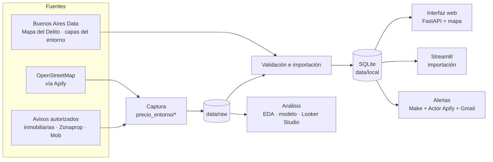

# Precio y Entorno CABA

Herramienta de búsqueda de departamentos en la Ciudad de Buenos Aires que combina avisos autorizados con datos abiertos del entorno. Ayuda a intermediarias inmobiliarias y a compradores a decidir **en qué barrios concentrar una búsqueda y qué avisos revisar primero**, y avisa cuando aparece una opción nueva compatible.

Proyecto capstone · estado al 17 de noviembre de 2026.

**Flujo del producto:** preferencias → comparación de barrios → búsqueda guardada → alerta por aviso nuevo.

## Qué hace

- **Compara barrios** según presupuesto, superficie, ambientes y lo que importa del entorno: subte, verde, escuelas, salud, ruido, riesgo hídrico, movilidad y más. Las capas se muestran por separado; no se combinan en un puntaje.
- **Muestra los avisos compatibles** de cada barrio en un mapa, con precio publicado por m², datos del edificio y distancias en línea recta a servicios.
- **Guarda búsquedas y envía alertas** por correo cuando una captura posterior trae un aviso nuevo que cumple los filtros.
- **Estima una referencia de precio publicado por m²** con un modelo evaluado fuera de muestra, para priorizar qué avisos revisar.
- **Muestra los delitos registrados como contexto**, siempre con su período y su unidad geográfica.

Opera en venta (USD) y alquiler (ARS o USD, sin convertir monedas). El análisis del capstone se limita a venta en USD.

## Resultados del análisis

Sobre un corte de 3.806 avisos de venta en USD capturados del 7 al 9 de noviembre de 2026, con validación cruzada de 5 pliegues agrupada por inmueble:

| Pregunta | Resultado |
| --- | --- |
| ¿Un modelo anticipa el precio publicado por m² mejor que la mediana de comparables? | **Sí.** HistGradientBoosting: MAE de 469 USD/m², y de 400 al sumar antigüedad, cocheras y rasgos de la descripción, frente a 584 de los comparables |
| ¿Los delitos registrados agregan información más allá de la ubicación? | **No.** Con la proximidad a servicios incluida, la mejora es de 2 USD/m², cambia de signo entre pliegues y no supera a un placebo |
| ¿La herramienta ahorra tiempo de búsqueda? | **Pendiente.** El protocolo de validación con una inmobiliaria está definido; el piloto no se realizó |

Detalle en [Fenómeno y targets](docs/entrega-fenomeno-targets.md), [Métrica de negocio](docs/entrega-metrica-negocio.md) y [Evaluación del modelo](docs/modelo.md).

## Arquitectura



- **Captura:** adaptadores propios con acceso educado (robots.txt, pausas, sin proxies) y actores de Apify con tope de gasto por corrida.
- **Almacenamiento:** una base SQLite por operación y modo (demo o real). Los crudos y las bases quedan fuera de Git.
- **Producto:** interfaz web propia servida por FastAPI, también publicada en Vercel. Streamlit queda para importar datos y probar la actualización.
- **Automatización:** tarea de Windows cada 2 días para capturar e importar; Make y un Actor de Apify para las alertas por correo; Make, Apify y Looker Studio para el pipeline de Analytics.

Detalle técnico en [arquitectura.md](docs/arquitectura.md).

## Datos

| Fuente | Aporta | Acceso |
| --- | --- | --- |
| RE/MAX, Century 21, Migliorisi | Avisos de venta y alquiler | Lectura autorizada de sus sitios |
| Zonaprop | Avisos de venta y alquiler, con antigüedad y cocheras | Autorización escrita; actor de Apify |
| Mob | Avisos de alquiler de dueños | Lectura autorizada |
| [Mapa del Delito de CABA](https://data.buenosaires.gob.ar/dataset/delitos) | Hechos registrados 2024–2025 | Datos abiertos |
| Buenos Aires Data | Subte, parques, escuelas, salud, ruido, riesgo hídrico, garajes, clubes, ciclovías, Ecobici, bibliotecas, rampas, colectivos | Datos abiertos |
| OpenStreetMap | Gastronomía y gimnasios | ODbL; la gastronomía se capturó vía Apify |

Contrato de cada fuente, validaciones y procedencia en [datos.md](docs/datos.md).

**Criterios que se aplican en todo el proyecto:**

- Los precios son **de publicación**, no tasaciones ni precios de cierre.
- Los delitos son **hechos registrados** de un período y un territorio. No miden el riesgo de una persona y no se convierten en un puntaje de seguridad.
- Los **datos ficticios** de la demo están separados de los reales y se rotulan en la interfaz.
- No se guardan **datos de contacto** de anunciantes ni el texto de las descripciones.
- Una asociación entre entorno y precio **no es causal**.

## Inicio rápido

Requiere Python 3.13 en Windows. Desde la carpeta del proyecto, en PowerShell:

```powershell
python -m venv .venv
.\.venv\Scripts\Activate.ps1
python -m pip install -r requirements.txt
```

Si PowerShell bloquea `Activate.ps1`, usá `.\.venv\Scripts\python.exe` en lugar de `python` en los comandos siguientes.

**Interfaz web.** Primero se generan las capas del mapa, una sola vez:

```powershell
python -m precio_entorno.entorno
python -m precio_entorno.api
```

Abrí http://127.0.0.1:8000. La documentación de la API está en http://127.0.0.1:8000/api/docs. La interfaz abre con los datos de ejemplo; el selector de arriba a la derecha pasa a los datos reales, si están las bases en `data/local/`.

**Importación y demo con Streamlit:**

```powershell
python -m streamlit run app.py
```

La primera carga crea `data/local/demo.sqlite3` con avisos ficticios. Para la demo: comparar Caballito, Almagro y Villa Crespo, guardar una búsqueda en Caballito e importar el lote nuevo. Aparece una alerta. Al reimportar el mismo lote no se genera otra.

**Pruebas:**

```powershell
python -m unittest discover -s tests -v
node --test tests/test_web_delitos.cjs tests/test_web_necesidades.cjs
```

Las pruebas usan datos sintéticos y ficticios y no hacen pedidos a la red.

## La interfaz web

- **Filtros:** comprar o alquilar, presupuesto, superficie, ambientes y lo que importa del entorno. Los cambios se aplican al escribir.
- **Mapa de la ciudad:** cada barrio se colorea según cuántos avisos encajan. Lista y mapa se resaltan entre sí.
- **Ficha del barrio:** entorno, avisos compatibles, barrios con entorno parecido y **Crear alerta**. Las capas del mapa se encienden y apagan por separado.
- **Registros cerca del aviso:** radios de 250, 500 y 1.000 m con robos y hurtos por franja y año. Ver [metodología y límites](docs/mapa-registros.md).
- **Estacionamientos y cocheras:** garajes comerciales y cocheras en alquiler mensual cerca de un aviso o de la ubicación del navegador. Ver [cocheras.md](docs/cocheras.md).
- **Explorador de necesidades** (en prueba, con `?explorador=1`): traduce necesidades concretas en capas y datos del aviso, sin puntajes. Ver el [plan](docs/plan-explorador-necesidades.md).
- **Celular:** el mapa ocupa la pantalla y la lista sube desde abajo.

Diseño y decisiones de interfaz en [ui.md](docs/ui.md).

## Análisis reproducible

| Análisis | Comando | Documento |
| --- | --- | --- |
| EDA de avisos | `python -m precio_entorno.eda_avisos data/raw/<captura>` | [eda-avisos.md](docs/eda-avisos.md) |
| EDA de delitos | `python -m precio_entorno.eda_delitos` | [eda-delitos.md](docs/eda-delitos.md) |
| Evaluación con y sin delitos | `python -m precio_entorno.modelo data/raw/<captura>/avisos.json --catalogo <catálogo>` | [modelo.md](docs/modelo.md) |
| Comparación de seis modelos | `python -m precio_entorno.comparar_modelos --control-inmobiliaria` | [modelo.md](docs/modelo.md#comparación-de-seis-modelos--14-de-noviembre-de-2026) |
| Pipeline Analytics | `python -m precio_entorno.pipeline_analytics etl\|eda <archivo>` | [pipeline-analytics.md](docs/pipeline-analytics.md) |

Los notebooks de Colab están en `notebooks/`: [EDA de oportunidades](notebooks/eda_oportunidades.ipynb) y [benchmark de modelos](notebooks/benchmark_modelos.ipynb). Sus datos se empaquetan con `python -m precio_entorno.eda_colab`, sin contactos de anunciantes. La [auditoría metodológica](reports/auditoria_metodologica.md) revisa muestra, unidades, fuga de información y validación.

## Operación

Capturas, importación, actualización programada, alertas, radar y despliegue están en el [manual de operación](docs/operacion.md). En resumen:

- **Actualización:** tarea de Windows cada 2 días (`scripts/actualizar.cmd`).
- **Alertas:** Make lee las búsquedas activas, corre el Actor `precio-entorno-alertas` en Apify y envía un correo por persona.
- **Radar de tendencias barriales:** `python -m precio_entorno.radar`, los lunes a las 9:00. Es una capa editorial, separada de avisos y delitos. Ver [radar.md](docs/radar.md).
- **Publicación:** `python scripts/preparar_vercel.py --desplegar`. Mergear no despliega.
- **Presupuesto de extracción:** hasta USD 5 por cuenta de Apify y USD 25 en total.

### Configuración

Las claves van en `.env`, que nunca se sube a Git:

| Variable | Uso |
| --- | --- |
| `APIFY_TOKEN` (una línea por cuenta) | Capturas y Actores de Apify |
| `MAKE_API_TOKEN`, `MAKE_EQUIPO_EMAIL` | Crear los escenarios de Make y recibir sus avisos de fallo |
| `MAKE_BUSQUEDAS_WEBHOOK_URL` | Altas y bajas de búsquedas desde la web |
| `MAKE_WEBHOOK_URL` | Resumen de cada actualización (heredado) |
| `GOOGLE_MAPS_API_KEY` | «Dónde comer»; desactivado, ver el [manual](docs/operacion.md#9-funciones-desactivadas) |
| `OPENAI_API_KEY`, `PRECIO_ENTORNO_IA`, `PRECIO_ENTORNO_IA_TOPE_USD` | Interpretación de preferencias en texto; apagada salvo monto autorizado, ver [preferencias-ia.md](docs/preferencias-ia.md) |

## Estructura del repositorio

```text
precio_entorno/   Captura, validación, base, API, alertas, entorno, análisis y modelo
web/              Interfaz web (HTML, CSS y JavaScript sin build)
app.py            App de Streamlit para importar datos y probar la actualización
.actor/           Actor de Apify de alertas
actores/          Actor de Apify de analytics
scripts/          Tareas programadas y despliegue
notebooks/        Notebooks de Colab y sus generadores
reports/          Auditoría metodológica
docs/             Documentación del producto, los datos, el análisis y las entregas
tests/            Pruebas de Python (unittest) y de la web (node:test)
data/fixtures/    Datos ficticios para la demo y las pruebas
data/raw/         Capturas crudas (fuera de Git)
data/processed/   Capas y salidas generadas (fuera de Git)
data/local/       Bases SQLite y registros (fuera de Git)
```

## Documentación

| Tema | Documentos |
| --- | --- |
| Producto y alcance | [Alcance](docs/alcance.md) · [Interfaz](docs/ui.md) · [Mercado y competencia](docs/fase-1-mercado-competitividad.md) · [Pricing](docs/pricing.md) |
| Datos | [Contrato de datos](docs/datos.md) · [ETL](docs/etl.md) · [Registros cerca del aviso](docs/mapa-registros.md) · [Cocheras](docs/cocheras.md) · [Pedidos de acceso](docs/pedidos-de-acceso.md) |
| Análisis | [EDA de avisos](docs/eda-avisos.md) · [EDA de delitos](docs/eda-delitos.md) · [Modelo](docs/modelo.md) · [Auditoría](reports/auditoria_metodologica.md) |
| Técnica y operación | [Arquitectura](docs/arquitectura.md) · [Manual de operación](docs/operacion.md) · [Pipeline Analytics](docs/pipeline-analytics.md) · [Despliegue](docs/despliegue-vercel.md) · [Radar](docs/radar.md) |
| Capstone | [Plan de entrega](docs/plan-capstone.md) · [Producto 1 (12/11)](docs/entrega-12-11.md) · [Fenómeno y targets](docs/entrega-fenomeno-targets.md) · [Métrica de negocio](docs/entrega-metrica-negocio.md) · [Validación con inmobiliaria](docs/validacion-inmobiliaria.md) · [Flujo de trabajo](docs/flujo-de-trabajo.md) |

## Limitaciones conocidas

- **Representatividad:** el catálogo depende de las fuentes autorizadas y de los topes de captura; no cubre toda la oferta de CABA.
- **Ubicación:** ninguna fuente declara la precisión de sus pines. Las distancias por aviso se calculan desde el punto publicado y en línea recta.
- **Fuentes con acceso limitado:** la API de RE/MAX responde HTTP 403 a la captura local desde el 17/11/2026, y Clarín Inmuebles bloquea la lectura automatizada.
- **Datos abiertos desactualizados:** el GTFS de colectivos es de 2019 y la capa de rampas es un registro de obras de 2011 a 2016, no un inventario.
- **Alertas:** detectan IDs nuevos; la app no actualiza precios ni da de baja avisos que dejan de publicarse.
- **Validación con usuarios:** pendiente. No hay ahorro de tiempo ni retorno medidos.
