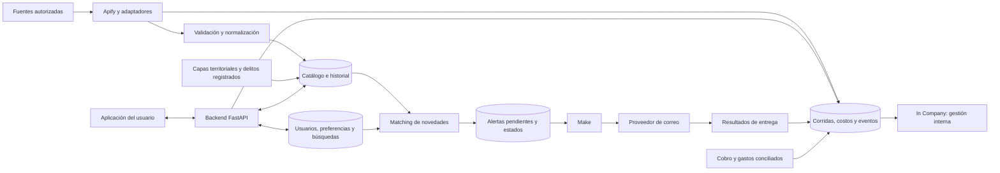
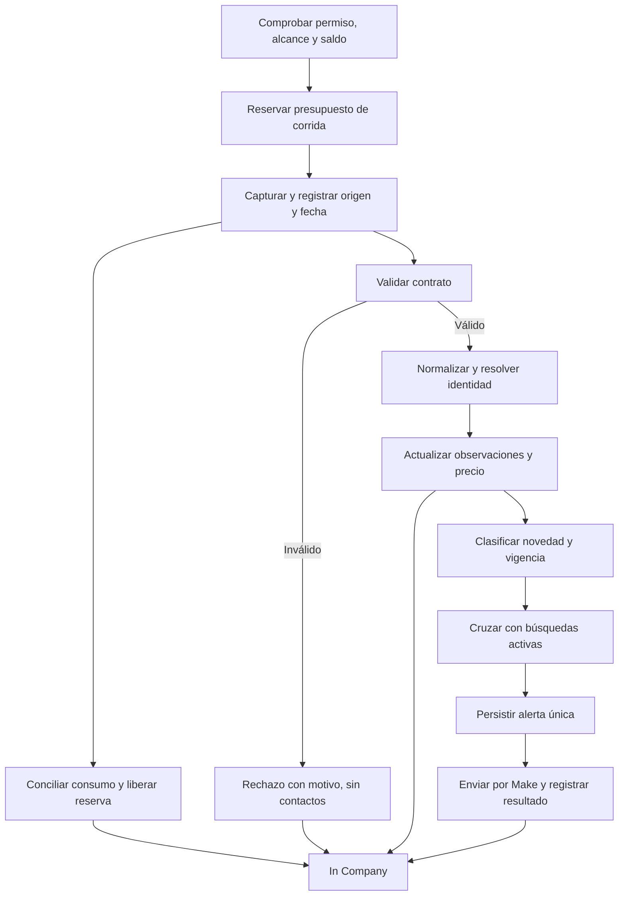

# Precio + Entorno CABA — Apunte fundamental del proyecto

Documento rector · versión 1.0 · 10 de noviembre de 2026.

**La idea:** ayudar a una persona que busca departamento a decidir dónde buscar y a detectar avisos compatibles con sus necesidades. El producto conecta preferencias y presupuesto con una comparación de barrios, permite guardar una búsqueda y avisa cuando detecta una publicación nueva que cumple sus criterios.

**El problema que se busca resolver:** elegir una zona y revisar repetidamente publicaciones exige combinar información dispersa de precios, características y entorno. La hipótesis de valor es que una selección explicada, con fuentes y fechas visibles, reduce ese trabajo y mejora la decisión. El repositorio demuestra capacidades técnicas; el ahorro de tiempo y la disposición a pagar todavía requieren validación con personas en búsqueda activa.

El usuario principal es quien busca comprar o alquilar un departamento en CABA. El usuario interno es el equipo que debe sostener el catálogo, controlar costos y aprender qué funciones aportan valor. Una inmobiliaria puede ser cliente de una oferta futura, pero no es el destinatario del módulo **In Company**, que administra la empresa que opera Precio + Entorno.

El flujo central es **preferencias → comparación de barrios → búsqueda guardada → alerta por aviso nuevo**. La arquitectura se organiza en cuatro partes:

1. [Arquitectura técnica](#1-arquitectura-técnica).
2. [Arquitectura de datos y web scraping](#2-arquitectura-de-datos-y-web-scraping).
3. [Estructura del sistema recomendador](#3-estructura-del-sistema-recomendador).
4. [Modelo de negocio, monetización y gestión In Company](#4-modelo-de-negocio-monetización-y-gestión-in-company).

**Cómo leer este documento.** “Actual” significa comprobado en el código o identificado expresamente como documentado. “Propuesta” define el comportamiento que se quiere construir. “Hipótesis” necesita evidencia antes de convertirse en una promesa comercial. Este apunte no constituye una migración de software ni la puesta en producción del panel interno.

## 1. Arquitectura técnica

### 1.1. Principio de diseño

La consulta del usuario y la captura de datos tienen tiempos y fallas diferentes. La interfaz debe consultar el último catálogo válido aunque una fuente esté caída. La extracción, limpieza y preparación de alertas deben ejecutarse en procesos separados, con estado y costos observables.

El catálogo es compartido: varias búsquedas utilizan una misma captura. Crear una búsqueda no debe disparar automáticamente una extracción paga individual. La escala comercial dependerá tanto de reutilizar datos como de adquirir usuarios.

### 1.2. Qué existe y cómo evolucionaría

| Componente | Estado actual revisado | Propuesta de evolución | Motivo |
| --- | --- | --- | --- |
| Web del usuario | HTML, CSS y JavaScript en `web/`, servidos por FastAPI | Evaluar Next.js y TypeScript al incorporar cuentas, planes y páginas públicas | Organizar una interfaz mayor sin reescribir antes de validar utilidad |
| Mapas | MapLibre GL JS y capas territoriales locales | Conservar MapLibre inicialmente | Ya integra el mapa; Leaflet es una alternativa, no una migración necesaria |
| Backend | FastAPI, validaciones y lógica Python | Mantener FastAPI; separar servicios de catálogo, búsquedas, alertas y gestión interna | Reutilizar contratos y lógica probados |
| Herramienta operativa | Streamlit para importación y prueba del flujo | Mantenerla como herramienta interna mientras se construye In Company | Evitar bloquear la operación por el desarrollo comercial |
| Persistencia | SQLite por operación y modo real/demo | PostgreSQL; incorporar PostGIS para consultas geográficas centralizadas | Concurrencia, permisos y datos compartidos entre procesos |
| Captura | Adaptadores de sitios autorizados y clientes/Actors de Apify | Jobs con límites, registro de corrida y recuperación | Separar fallas de fuente de la experiencia web |
| Automatización | Código de actualización, webhook y escenarios Make; Actor de alertas | Consolidar un circuito de entrega con estado auditable | Evitar que circuitos paralelos envíen dos veces la misma novedad |
| Correo | Integración documentada con Make, Gmail y Sheets | Evaluar un proveedor transaccional al medir volumen y entrega | El proveedor final depende de costos y necesidades comprobadas |
| Identidad y cobro | No se verificó una solución SaaS de cuentas y suscripciones | Autenticación, autorización por usuario, estado de suscripción y cancelación | Las búsquedas privadas y el pago requieren controles propios |
| In Company | Hay registros operativos; no se identificó un panel integral | Panel privado de finanzas, producto y operación | Convertir registros dispersos en decisiones verificables |

FastAPI dispone de contratos tipados y documentación de API; ya forma parte del proyecto. Next.js aporta un marco React para una futura interfaz más amplia. La elección es de evolución, no una exigencia del piloto. Fuentes: [FastAPI](https://fastapi.tiangolo.com/) y [Next.js](https://nextjs.org/docs).

PostGIS será útil cuando las consultas espaciales deban resolverse dentro de PostgreSQL; las capas locales actuales siguen siendo válidas para el prototipo. Referencia: [documentación PostGIS](https://postgis.net/documentation/).

Redis, Celery, embeddings, pgvector y Pinecone quedan fuera de la primera arquitectura comercial. Se evaluarán si aparece una necesidad medida de cola especializada, caché o recuperación semántica. Un ranking por preferencias explícitas no necesita por sí mismo una base vectorial.

### 1.3. Arquitectura objetivo y conexión con In Company

El siguiente diagrama representa la **propuesta SaaS**, no un despliegue existente:

Apify puede notificar eventos de corrida mediante un POST a un webhook. Make recibe webhooks y puede procesarlos inmediatamente o mediante programación. Esto permite conectar etapas, pero no garantiza por sí solo detección o entrega instantáneas. Fuentes: [webhooks de Apify](https://docs.apify.com/integrations/webhooks) y [webhooks de Make](https://help.make.com/webhooks).

### 1.4. Pantallas y responsabilidades

| Pantalla | Qué permite decidir o hacer | Información indispensable |
| --- | --- | --- |
| Preferencias | Definir operación, moneda, presupuesto, superficie, ambientes e intereses | Requisitos obligatorios separados de gustos |
| Comparación | Elegir barrios para explorar | Coincidencias, precios de publicación, contexto, fuentes y cobertura |
| Barrio y avisos | Revisar opciones concretas | Precio, características, precisión de ubicación, última observación y enlace |
| Búsqueda guardada | Mantener o pausar el seguimiento | Criterios guardados, consentimiento de correo y frecuencia efectiva |
| Alerta | Evaluar una novedad | Motivo de coincidencia, fecha de detección y acceso a la fuente |
| In Company | Controlar servicio y negocio | Período, métricas, costos, alertas operativas y procedencia del dato |

Si no hay coincidencias, la aplicación explicará qué filtros limitan la oferta y permitirá guardar la búsqueda. No ampliará el presupuesto ni cambiará de moneda sin una decisión de la persona. Si una capa no está disponible, mostrará “sin datos” y conservará las consultas que sí pueden resolverse.

### 1.5. Seguridad, operación y acceso interno

**Propuesta:** autenticar por separado a usuarios y personal interno; validar permisos en el backend y la propiedad de cada búsqueda. Ocultar un botón no constituye autorización. Los tres roles internos serán:

- **Administración:** permisos, configuración y presupuestos; cambios sensibles con autor, fecha y motivo.
- **Finanzas:** gastos, conciliación, presupuestos y proyecciones; sin acceso general a los contactos de usuarios.
- **Producto y operación:** eventos agregados, cobertura, errores, demanda y calidad de alertas; sin edición de límites financieros.

Las vistas agregadas serán el acceso habitual. Para cohortes de producto menores de cinco personas, se ocultará el desglose o se ampliará el segmento; este umbral es una protección inicial, no una garantía de anonimato. La inspección individual excepcional tendrá finalidad operativa y auditoría.

Los secretos permanecerán en configuración privada, nunca en Git o en registros. Los contactos de anunciantes no formarán parte del catálogo. Los correos de suscriptores se tratarán dentro del circuito de entrega, separados de los eventos analíticos. Se documentarán copias de seguridad, restauración y estado de la última actualización antes de ofrecer servicio continuo.

## 2. Arquitectura de datos y web scraping

### 2.1. Fuentes, alcance y límites

El análisis central del capstone utiliza **un catálogo autorizado de avisos vigentes y el Mapa del Delito de CABA**. Apify y Make son herramientas del flujo, no fuentes analíticas independientes. El catálogo puede consolidar varias fuentes autorizadas conservando el origen de cada publicación.

| Familia | Qué representa | Tratamiento |
| --- | --- | --- |
| Avisos reales | Oferta observada de departamentos | Precio publicado, operación, moneda, origen y observación |
| Delitos registrados | Hechos incluidos en la fuente oficial para un período y territorio | Contexto con cobertura, metodología y unidad geográfica |
| Entorno | Transporte, espacios verdes, escuelas, salud, ruido y riesgo hídrico disponibles | Capas con fuente, fecha, unidad y límites de interpretación |
| Radar editorial | Cobertura de los medios monitoreados sobre barrios y aperturas | Capa separada; no equivale a demanda ni conserva textos de notas |
| Datos ficticios | Ejemplos y pruebas | Modo explícito; excluidos de métricas reales y comerciales |
| Datos de empresa | Gastos, corridas, uso y solicitudes de usuarios | Acceso interno y definiciones reproducibles |

El piloto de referencia permanece acotado a **hasta 50 avisos de Caballito y Almagro, hasta USD 5 en una sola cuenta de Apify**. El límite total de extracción es **USD 25**, con un máximo de **USD 5 por cuenta**. La documentación ya registra capturas posteriores de mayor cobertura: esos antecedentes no amplían automáticamente los topes ni prueban cobertura actual completa.

El saldo disponible debe obtenerse del registro consolidado y de consumos conciliados. Hay cifras históricas de gasto y catálogo de distintos cortes en README y arquitectura; no se adoptan aquí como saldo o inventario vigente. El permiso de cada fuente debe cubrir el uso previsto; este apunte no habilita nuevas capturas ni redistribución comercial.

### 2.2. Pipeline y estados

**Propuesta operativa:** cada corrida conservará ID, fuente, cuenta identificada por alias, alcance, inicio y fin, estado completo/parcial/error, filas recibidas, válidas, nuevas y rechazadas, costo estimado y costo informado. Una corrida parcial puede aportar observaciones válidas, pero no justificar bajas por ausencia.

La primera carga del Actor de alertas establece una base por defecto; luego se notifican novedades. El circuito local y el Actor no son idénticos: la base local puede generar coincidencias al importar, mientras el Actor conserva IDs vistos por operación. La evolución deberá hacer explícito el comportamiento de cada alta y unificar la identidad de alertas antes de activar ambos circuitos para una misma búsqueda.

### 2.3. Diccionario conceptual

Los nombres siguientes definen conceptos; no son una migración ni un contrato API nuevo.

| Entidad | Campos o relaciones mínimos | Regla |
| --- | --- | --- |
| Aviso | ID de origen, fuente, URL, operación, barrio | La identidad se conserva dentro de la fuente; el catálogo puede contener varios prefijos |
| Observación | Aviso, corrida, fecha observada, precio, moneda | Una observación antigua no sobrescribe el estado más reciente |
| Características | Ambientes, m² cubiertos, m² totales, expensas cuando existen | No intercambiar superficies; indicar moneda y período de gastos |
| Localización | Coordenadas, barrio y precisión declarada | Una ubicación aproximada no se vuelve exacta por geocodificarla |
| Vigencia | Última observación, estado, fecha y evidencia | “Observado” o “baja inferida” no prueba disponibilidad comercial |
| Indicador territorial | Tipo, valor, unidad, período, territorio, fuente y cobertura | Un dato faltante no es cero |
| Preferencias | Operación, moneda, requisitos, intereses y pesos | Los pesos solo afectan preferencias, nunca eliminan requisitos |
| Búsqueda | Propietario, criterios, versión, alta, pausa y consentimiento | La edición conserva la versión que explicó una alerta anterior |
| Alerta | Búsqueda, aviso, tipo de novedad, detección y estado de envío | Un reintento no crea una novedad distinta |
| Corrida | Fuente, alcance, cuenta, estados, conteos y costos | Distinguir captura parcial de barrido completo |
| Presupuesto y gasto | Período, categoría, moneda, proveedor, importe y evidencia | Separar presupuesto aprobado, compromiso pendiente y gasto real |
| Evento de uso | ID, fecha, actor seudónimo, acción, objeto y versión | Excluir pruebas, robots identificados y actividad interna |
| Solicitud de mejora | Categoría, solicitante seudónimo, fecha y estado | Contar solicitantes únicos además de pedidos |

Para dinero, la propuesta PostgreSQL utilizará decimales exactos o unidades monetarias enteras con escala documentada. La documentación de PostgreSQL recomienda `numeric` cuando se requiere exactitud, incluidos importes monetarios. [Tipos numéricos](https://www.postgresql.org/docs/current/datatype-numeric.html).

### 2.4. Normalización, duplicados y vigencia

**Moneda y operación.** La aplicación actual compara venta en USD y alquiler en ARS o USD por separado. Se conservará ese criterio. Cualquier conversión futura será una vista derivada con tipo de cambio, fuente y fecha; nunca reemplazará el precio original. El alquiler mensual y el precio de venta no se comparan como una misma magnitud. Las expensas no están incluidas salvo indicación expresa.

**Duplicados.** El mismo ID de una fuente no debe crear dos avisos. Dos publicaciones de fuentes diferentes pueden representar una misma propiedad, pero similitud de superficie, ubicación o texto solo genera un candidato a revisión. Se conservarán los registros originales y la evidencia de agrupación. No se anunciará un catálogo “sin duplicados” antes de medir la precisión del proceso.

**Vigencia actual.** `store.py` ya conserva historial de precios, última observación y estados; contempla `activo`, `no_visto` y `baja`, y reactivación. Dos ausencias consecutivas en barridos completos pueden producir una baja; existe una protección ante desapariciones masivas. Esto es una inferencia operativa, no una confirmación de venta o alquiler. Las capturas de avisos recientes no permiten concluir que los demás desaparecieron. Véase [pruebas de vigencia](../tests/test_vigencia.py).

**Propuesta de presentación.** Mostrar última observación y origen del estado. Un 404 persistente, una redirección o una ficha retirada deben interpretarse según la fuente; un bloqueo o una falla temporal deben quedar como error de verificación. No borrar el historial para ocultar una incertidumbre.

**Delitos y entorno.** Conservar período, unidad territorial y cobertura. Los conteos de barrios de diferente tamaño no equivalen a tasas comparables de riesgo. Un radio alrededor de un aviso no describe todo el barrio; una distancia en línea recta no es tiempo a pie. La comparación territorial usará definiciones compatibles. Metodología local: [mapa de registros](mapa-registros.md) y [datos](datos.md).

### 2.5. Eventos para In Company

**Propuesta:** registrar eventos de negocio con un identificador único, fecha UTC, versión de esquema, modo real/demo, operación, sesión o usuario seudónimo y objeto relacionado. Los tableros mostrarán períodos en `America/Argentina/Buenos_Aires`. Los atributos serán una lista permitida, sin copiar el texto completo de formularios ni direcciones de correo.

| Evento conceptual | Cuándo se registra | Qué permite medir |
| --- | --- | --- |
| `preferencias_completadas` | La persona confirma requisitos válidos | Inicio del recorrido y composición de búsquedas |
| `comparacion_realizada` | Se muestran resultados, incluso vacíos | Activación, cobertura y búsquedas sin oferta |
| `indicador_consultado` | Se abre deliberadamente un indicador o capa | Interés observado en transporte, ruido, delitos, etc. |
| `filtro_aplicado` | Se aplica un valor confirmado, no cada tecla | Uso de filtros y fricción |
| `busqueda_guardada` / `busqueda_pausada` | El backend confirma el cambio | Seguimiento activo |
| `alerta_preparada` / `alerta_enviada` / `alerta_entregada` | Cada etapa se confirma por su sistema responsable | Embudo de entrega; falta de confirmación no cuenta como entrega |
| `aviso_abierto` | Se activa un enlace al aviso | Interés; no prueba contacto ni visita |
| `funcionalidad_solicitada` | Se registra un pedido categorizado | Demanda explícita |
| `suscripcion_activada` / `suscripcion_finalizada` | El sistema de cobro confirma el estado | Conversión y permanencia, cuando exista cobro |

Los eventos se deduplicarán por ID. Consultas repetidas de un mismo indicador se mostrarán como interacciones y, por separado, usuarios únicos. Los conteos del backend serán la referencia para búsquedas, suscripciones y envíos; los eventos del navegador pueden faltar por bloqueos o desconexiones.

Como propuesta inicial, conservar eventos detallados de uso durante 90 días y agregados mensuales durante 12 meses, sujeto a revisión de privacidad antes del lanzamiento. La retención contable se definirá aparte. No se promueve una política legal mediante este documento.

## 3. Estructura del sistema recomendador

### 3.1. Qué significa recomendar en este proyecto

Hay dos decisiones relacionadas: **qué barrios explorar** y **qué publicaciones revisar**. El producto debe explicar ambas. La comparación actual cuenta coincidencias y muestra precios medianos; las capas del entorno son descriptivas y no se combinan en un puntaje. Esto se verifica en [matching.py](../precio_entorno/matching.py), la interfaz y las pruebas de entorno.

El modelo de investigación del capstone evalúa predicción de precio publicado por m². Es un trabajo distinto del ranking personal y no valida tasaciones ni causalidad entre delitos y precios. Sus resultados y controles están en [modelo.md](modelo.md).

### 3.2. Módulo A — Afinidad con barrios

**Entradas:** operación, moneda, presupuesto máximo, superficie cubierta mínima, ambientes exactos o mínimos según la interfaz, barrios aceptados y preferencias de entorno respaldadas por datos.

**Propuesta de cálculo inicial: filtros más puntuación ponderada explicable.** Primero se calcula cuánta oferta del catálogo cumple los requisitos. Después se comparan dimensiones de entorno pertinentes. La persona decide pesos; si no los asigna, se usan pesos iguales entre las dimensiones elegidas, con esa decisión visible.

Para cada dimensión se documentará su unidad, dirección preferida y transformación a 0–1. La versión de la transformación se mantendrá fija para una edición del catálogo de indicadores; no se recalculará sobre los dos barrios visibles, lo que podría cambiar artificialmente el orden. Las dimensiones con valor objetivo usarán cercanía a ese objetivo, no “cuanto más, mejor”.

`Afinidad = 100 × suma(peso × indicador normalizado observado) / suma(pesos observados)`.

`Cobertura = suma(pesos observados) / suma(pesos elegidos)`.

**Regla propuesta para el MVP:** mostrar un puntaje solo si hay al menos 80 % de cobertura ponderada y no falta evidencia para un requisito obligatorio. El 80 % es un umbral de diseño a validar, no un estándar científico. Barrios con menor cobertura aparecerán como “información insuficiente”; no recibirán cero ni se mezclarán silenciosamente con los resultados completos. El puntaje es afinidad, no probabilidad de satisfacción.

El número de avisos compatibles se mostrará aparte de la afinidad. Un barrio puede ser atractivo para la persona y tener poca oferta observada. Los delitos registrados permanecerán como contexto separado del puntaje inicial: no se construirá una escala universal de seguridad. El radar editorial tampoco determinará automáticamente relevancia inmobiliaria.

### 3.3. Módulo B — Compatibilidad y orden de avisos

Los requisitos obligatorios funcionan como filtros. Un dato obligatorio desconocido impide afirmar compatibilidad; el aviso puede mostrarse aparte para revisión. Entre los compatibles, la propuesta ordena por ajuste a preferencias disponibles, con fecha de detección e ID como desempate estable. Precio menor no equivale por sí mismo a mejor inmueble.

Cada ficha explicará: qué requisitos cumple, qué preferencias favorecen su posición, qué datos faltan y cuándo se observó. Las preferencias a escala de barrio no se atribuirán a cada dirección como si fueran mediciones puntuales.

La comparación de precio por m² usará la misma operación, moneda, tipo de propiedad y definición de superficie. Mostrará mediana, dispersión, cantidad de comparables y fecha. Como regla inicial propuesta, con menos de diez comparables no se publicará una conclusión de precio relativo; podrá informarse que la muestra es insuficiente. Estar bajo la mediana puede deberse a estado, piso, ubicación o datos faltantes: no habilita la etiqueta “ganga”.

### 3.4. Matching, historial y alertas

Una búsqueda guardada conserva criterios y consentimiento. Al incorporar una novedad, el sistema evalúa las búsquedas activas y crea una alerta persistente antes de intentar enviarla. La propuesta de entrega usará una clave estable por búsqueda, aviso y clase de novedad, con estados pendiente, enviada, confirmada o fallida. Repetir un webhook o reintentar un correo no debe crear un nuevo evento comercial.

**Estado actual:** el circuito SQLite evita repetir la pareja búsqueda/aviso y puede generar una primera coincidencia por cambio de precio o reactivación. El Actor está orientado a IDs nuevos y toma la primera corrida como base por defecto. Por eso no se promete aún un servicio unificado de alertas por cada baja de precio: requiere definir eventos, consentimiento y comportamiento de ambos circuitos.

Pausar una búsqueda deberá cancelar pendientes que aún no se hayan enviado. Cambiar filtros no transformará todo el catálogo histórico en novedades. La fecha de primera detección se separará de la fecha de publicación, que puede desconocerse.

La documentación describe ciclos de dos días en los circuitos existentes; su activación remota no fue comprobada para este apunte. La promesa será **“te avisamos cuando detectamos una coincidencia”**, mostrando la frecuencia observada. Medir por separado demora de publicación a detección —cuando se conozca la publicación— y demora de detección a entrega.

### 3.5. Ejemplo completo — Todos los valores son ficticios

Ana busca alquilar en ARS, hasta ARS 800.000 mensuales sin expensas, al menos 40 m² cubiertos y dos ambientes. Compara Caballito y Almagro y prioriza transporte con peso 0,6 y espacios verdes con peso 0,4.

| Barrio ficticio del ejemplo | Transporte normalizado | Verdes normalizado | Afinidad | Avisos compatibles ficticios |
| --- | ---: | ---: | ---: | ---: |
| Caballito | 0,8 | 0,7 | 76/100 | 6 |
| Almagro | 0,9 | 0,4 | 70/100 | 9 |

Ambos tienen cobertura completa en este ejemplo. Ana puede preferir Caballito por afinidad aunque Almagro tenga más avisos. Estos valores no describen los barrios reales.

Ana guarda Caballito. Una corrida posterior detecta un aviso nuevo por ARS 760.000, 43 m² cubiertos y dos ambientes; pasa los filtros. Las expensas faltantes se muestran como desconocidas: no se afirma que su costo mensual total sea ARS 760.000. Se prepara una alerta y se registra el resultado del envío. Reimportar el lote no produce otra alerta.

In Company registra una comparación, una búsqueda guardada y una alerta; si Ana abre el aviso, registra el clic. No registra una visita inmobiliaria ni una contratación sin evidencia. Si consulta transporte tres veces, cuenta tres interacciones y una usuaria única. Si además pide “tiempo a pie al trabajo”, genera una solicitud explícita distinta del uso de transporte.

### 3.6. Evaluación del valor

La métrica principal propuesta es **porcentaje de búsquedas activas evaluadas que recibieron al menos una coincidencia nueva que su titular calificó como útil**. El denominador incluirá las búsquedas invitadas que completaron la evaluación, incluso si no recibieron avisos. Se mostrará también la tasa de respuesta para no confundir respuestas voluntarias con toda la población.

Se acompañará con tiempo ahorrado declarado, búsquedas sin resultados, avisos aún disponibles al abrir, latencia y costo por búsqueda. Clics, volumen de correos y número de capas consultadas son señales auxiliares, no pruebas de utilidad. La validación seguirá el [protocolo existente](validacion-inmobiliaria.md), adaptando el instrumento a personas en búsqueda cuando corresponda.

## 4. Modelo de negocio, monetización y gestión In Company

### 4.1. Oferta y unidad de cobro

**Hipótesis principal acordada:** una suscripción mensual durante la búsqueda activa. La unidad de valor es una búsqueda explicada y seguida en el tiempo, no la cantidad de mensajes enviados. La persona debe conocer cobertura, frecuencia, precio, renovación y forma de cancelar antes de pagar.

| Plan propuesto | Destinatario y valor | Funciones | Hipótesis de precio |
| --- | --- | --- | --- |
| Explorer | Persona que evalúa zonas y calidad del servicio | Comparación básica y muestra de avisos reales; guardar interés sin activar seguimiento pago | Gratis |
| Pro / Búsqueda activa | Persona que quiere sostener el seguimiento | Búsquedas guardadas, lista compatible y alertas por avisos nuevos | USD 10–20 por mes como referencia a validar |
| Enterprise | Organización con una necesidad analítica comprobada | Informes agregados o servicios de datos autorizados | USD 50 o más por mes como referencia a validar |

Los límites de búsquedas y muestras no se fijan arbitrariamente en esta etapa: deberán probarse junto con carga operativa y valor percibido. Historial visible, avisos de baja de precio y recomendaciones más avanzadas se incorporarán según capacidad real. No se venderá acceso a datos personales de búsquedas como parte implícita de Enterprise.

El repositorio contiene una hipótesis anterior de pase de 30 días por USD 9 o USD 15, sin renovación automática, y una oferta B2B diferente. Se conservan como experimentos alternativos, no como planes vigentes simultáneos. Ver [pricing de búsqueda personal](pricing-busqueda-personal.md) y [pricing B2B](pricing.md). Antes de una prueba comercial se elegirá una oferta y se registrará su versión para no mezclar conversiones de productos distintos.

**Hipótesis pendiente:** una búsqueda puede durar uno a tres meses. Cancelar porque se encontró departamento puede representar éxito del producto. La estrategia debe medir motivos y captación sostenible; no asumir que prolongar cualquier suscripción es beneficioso para el cliente.

### 4.2. In Company — Módulo propio de la empresa

Su propósito es responder cinco preguntas: **cuánto podemos gastar, cuánto cuesta prestar el servicio, cómo se usa, qué se pide y qué resultado produce**. Será un área privada del equipo, no un cuarto plan comercial.

| Vista interna | Contenido concreto | Decisión que habilita |
| --- | --- | --- |
| Resumen ejecutivo | Gasto, saldo, búsquedas activas, coincidencias útiles, ingreso y fallas | Detectar desvíos y priorizar atención |
| Presupuesto | Partidas por período/proveedor, aprobado, real, comprometido y saldo | Autorizar trabajo dentro del límite existente |
| Costos y rentabilidad | Captura, infraestructura, correo, Make, soporte y cobro | Entender costo unitario y margen |
| Uso de la app | Embudo, usuarios activos, recurrencia y búsquedas sin resultados | Identificar fricción y cobertura insuficiente |
| Métricas y funciones demandadas | Indicadores consultados y pedidos explícitos separados | Priorizar nuevas capas y funciones |
| Operación y calidad | Última captura, fallas, registros válidos, duplicados y entregas | Resolver incidentes que afectan el valor |
| Escenarios | Usuarios, conversión, precio, frecuencia y costos editables | Proyectar necesidades antes de ampliar cobertura |

Todas las vistas mostrarán período, comparación con período equivalente, fecha de actualización, definición y estado de calidad. Un dato faltante aparecerá como “no medido”. Las comparaciones de un mes incompleto usarán igual cantidad de días; no enfrentarán automáticamente diez días contra un mes completo.

### 4.3. Presupuestación y control del gasto

Cada partida tendrá período o proyecto, categoría, proveedor, responsable, moneda, importe aprobado y evidencia. Los gastos tendrán ID externo o comprobante para prevenir carga duplicada, fecha de consumo, fecha de pago y estado de conciliación. La carga manual será válida para el piloto si deja trazabilidad.

- **Gasto real:** consumo confirmado, aunque aún no se haya pagado; el pago se sigue aparte.
- **Comprometido pendiente:** importe reservado para trabajo autorizado aún no contabilizado como real.
- **Saldo disponible:** presupuesto aprobado menos gasto real menos comprometido pendiente.
- **Desvío absoluto:** gasto real menos presupuesto del mismo alcance y período.
- **Desvío porcentual:** desvío absoluto dividido por presupuesto; con presupuesto cero se muestra “no aplica”.

Al conciliar una corrida, su consumo pasa a real y se libera o ajusta la reserva; no se suma dos veces. La proyección de fin de período será real más compromisos pendientes más consumo adicional esperado, indicando supuestos.

**Propuesta de control:** aviso al alcanzar 80 % del presupuesto y bloqueo de nuevas corridas cuando su máximo reservado exceda el saldo. La reserva debe ser atómica para impedir que dos trabajos gasten el mismo saldo. Se comprobarán simultáneamente tope de corrida, piloto, cuenta y proyecto. Si el proveedor no permite garantizar un límite compatible, no se habilitará la ejecución paga.

El tope del proyecto no se reinicia por abrir otra cuenta ni por cambiar de mes. Los límites mensuales del proveedor son controles adicionales. La extracción de puntos de interés también debe entrar al registro consolidado cuando corresponda al presupuesto de extracción. Una tarifa cambiada o saldo no conciliado exige resolver la discrepancia antes de presupuestar otra corrida.

ARS y USD se mostrarán separados; una vista consolidada necesita moneda de reporte, tipo de cambio, fecha y fuente. Los importes de planificación no deben sustituir comprobantes o consumos reales.

### 4.4. Costos y modelo económico

| Categoría | Comportamiento esperado | Forma de atribución propuesta |
| --- | --- | --- |
| Catálogo y verificación | Compartido entre usuarios; crece por cobertura y frecuencia | Por fuente, operación y corrida; reparto analítico explícito |
| Infraestructura | Base fija más consumo | Por período; separación de desarrollo y operación |
| Make y correo | Depende de ejecuciones y mensajes, además del plan | Por ejecución/envío cuando haya datos; saldo común identificado |
| Mapas y geocodificación | Depende del proveedor y consultas | Por operación medible, sin asumir costo cero |
| Cobro | Comisiones y devoluciones | Por transacción conciliada |
| Soporte | Tiempo de atención | Minutos por búsqueda por costo horario supuesto o real |
| Adquisición | Campañas y trabajo comercial | Por cohorte y canal, con atribución declarada |

`Contribución = ingreso neto del período − costos variables del servicio`.

`Resultado operativo del escenario = contribución − costos fijos/compartidos − adquisición`.

Para un precio mensual P, costo variable por cliente V y costo fijo/compartido F, el equilibrio simplificado es `techo(F / (P − V))`, solo si `P > V`. Es una aproximación que excluye lo que no se haya incluido explícitamente en F o V; no es beneficio neto contable.

**Ejemplo ficticio, no presupuesto aprobado ni tarifa de proveedores:** P = USD 15, V = USD 3 por cliente pago y F = USD 120 mensuales.

| Clientes pagos durante el mes completo | Ingreso | Costo variable | Contribución | Resultado antes de adquisición e impuestos |
| ---: | ---: | ---: | ---: | ---: |
| 5 | USD 75 | USD 15 | USD 60 | USD −60 |
| 10 | USD 150 | USD 30 | USD 120 | USD 0 |
| 20 | USD 300 | USD 60 | USD 240 | USD 120 |

El equilibrio ilustrativo es diez clientes. Si captar cada cliente cuesta USD 18, la contribución de un mes no recupera esa adquisición. La comparación de precios deberá evaluar conversión, duración de búsqueda, costos y devoluciones en conjunto. El presupuesto de USD 25 del capstone es un límite experimental distinto de este escenario comercial hipotético.

### 4.5. Diccionario de métricas empresariales

Por defecto, producto usa ventanas móviles de 7 y 30 días y finanzas meses calendario. Los usuarios activos son personas únicas con una acción relevante —comparar, guardar, consultar un indicador o abrir un aviso—, no simples visitas. Una búsqueda activa es guardada, no pausada ni eliminada durante la fecha de corte; para costos por período se usa su promedio diario.

| Métrica | Definición o fórmula | Fuente y frecuencia | Límite de interpretación |
| --- | --- | --- | --- |
| Usuarios activos 7/30 días | Personas únicas con acciones relevantes en la ventana | Eventos; diario | Sin identidad estable no se infieren personas entre dispositivos |
| Comparación a búsqueda guardada | Usuarios que comparan y guardan dentro de 7 días / usuarios de la cohorte que comparan | Eventos y backend; semanal | Usar cohortes con ventana completa y tamaño visible |
| Búsquedas sin resultados | Evaluaciones confirmadas con cero coincidencias / evaluaciones confirmadas | Backend; diario | Informar además búsquedas únicas; no contar cada tecla |
| Indicadores utilizados | Usuarios únicos por indicador y número de interacciones | Eventos; semanal | Uso depende de exposición y ubicación en pantalla |
| Funciones solicitadas | Solicitantes únicos por categoría y pedidos totales | Registro de solicitudes; semanal | Repetir un pedido no son varios clientes |
| Coincidencias útiles | Búsquedas evaluadas con al menos una novedad útil / búsquedas evaluadas | Encuesta vinculada; semanal | Acompañar tasa de respuesta y búsquedas sin avisos |
| Entrega confirmada | Mensajes con confirmación del proveedor / mensajes enviados de la cohorte | Proveedor; diario, cohorte madura a 72 h | Si no hay confirmación, mostrar estado desconocido |
| Clic en alerta | Alertas entregadas con al menos un clic medido / alertas entregadas | Redirección o proveedor; semanal | Mostrar ventana de 7 días y excluir clics automatizados detectados |
| Frescura del catálogo | Distribución de tiempo desde última observación por fuente | Catálogo; diario | Observación reciente no prueba disponibilidad actual |
| Éxito de corridas | Corridas completas / corridas terminadas | Registro de ejecución; diario | Mostrar parciales y fallidas por separado |
| Costo por aviso válido nuevo | Gasto de captura de un lote / IDs válidos incorporados por primera vez | Corrida y catálogo; por lote | Si no hay nuevos, indicar “sin nuevos”; el gasto permanece |
| Costo por búsqueda activa | Costo del servicio del período / promedio diario de búsquedas activas | Costos y backend; mensual | Es reparto gerencial, no costo marginal |
| Conversión a pago | Personas elegibles que pagan en 30 días / personas elegibles expuestas a la oferta | Oferta y cobro; por cohorte | Separar precio, operación y versión del plan |
| Suscripciones activas | Contratos recurrentes vigentes al corte con derecho de acceso | Cobro; diario | Diferenciar pausa, cancelación programada e impago |
| MRR | Suma de importes recurrentes mensuales netos de descuentos al corte | Suscripciones; mensual | Excluye pases únicos, impuestos y cobros no recurrentes |
| Ingresos cobrados | Cobros liquidados menos reembolsos, impuestos identificados aparte | Conciliación; mensual | No equivale a MRR ni a ingreso devengado |
| ARPPU | MRR / clientes con suscripción recurrente activa al corte | Suscripciones; mensual | Solo población paga; no denominarlo ARPU total |
| Margen de contribución | (Ingreso neto devengado − costos variables) / ingreso neto devengado | Registro económico; mensual | Con ingreso cero, no aplica; faltan costos fijos |
| Churn de clientes | Clientes del inicio cuya última suscripción termina en el mes / clientes activos al inicio | Suscripciones; mensual | Separar éxito de búsqueda, precio, falta de valor e impago |
| Retención por cohorte | Clientes de una cohorte inicial aún activos al hito / clientes iniciales de esa cohorte | Suscripciones; mensual | No sumar altas posteriores al denominador |

Los cocientes con denominador cero o fuente ausente serán “no aplica” o “no medido”, nunca cero por defecto. Cada métrica tendrá versión, responsable y detalle de exclusiones. La tasa de aperturas de correo no será la medida principal de utilidad.

CAC se incorporará cuando existan gastos de adquisición y atribución confiable: gasto de adquisición de una cohorte dividido por nuevos clientes pagos atribuibles. La recuperación de CAC usará contribución acumulada observada por cohorte. LTV se estimará con historial suficiente de contribución y duración; no se aplicará automáticamente una fórmula de perpetuidad a una búsqueda episódica. NRR tendrá sentido si aparecen expansiones y contracciones de suscripciones medibles.

### 4.6. Métricas más usadas y funciones más pedidas

In Company tendrá dos rankings independientes:

1. **Uso observado:** indicadores consultados —por ejemplo, precio por m², transporte, ruido o delitos registrados—, usuarios únicos, interacciones y exposición. Un indicador visible por defecto no se considerará “pedido”.
2. **Demanda explícita:** solicitudes categorizadas —por ejemplo, tiempo de viaje, accesibilidad o historial de precios—, solicitantes únicos, segmento, problema declarado y estado de evaluación.

La priorización combinará alcance, evidencia de utilidad, factibilidad de datos, costo y confianza. Una función muy pedida puede requerir una fuente que aún no existe; una función poco usada puede estar mal ubicada. No se trasladará automáticamente el primer puesto de un ranking a la hoja de ruta.

El registro de decisión conservará problema, evidencia, propuesta, esfuerzo estimado, responsable, resultado esperado y fecha de revisión. La publicación de métricas agregadas a terceros será una oferta aparte, con revisión de permisos y privacidad.

### 4.7. Escenarios, riesgos y etapas

El simulador interno permitirá editar usuarios activos, conversión a pago, precio, retención, fuentes, frecuencia de captura, avisos por corrida, mensajes, soporte y costos unitarios. Mostrará escenarios conservador, base y favorable, siempre rotulados como supuestos. El costo del catálogo no crecerá linealmente con usuarios si se reutiliza, pero podrá aumentar por cobertura o mayor frecuencia.

| Riesgo | Señal observable | Respuesta prevista |
| --- | --- | --- |
| Fuente bloqueada o permiso retirado | Errores o notificación de la fuente | Detener esa fuente y publicar cobertura efectiva; no asumir que proxies resuelven el acceso |
| Presupuesto excedido | Reservas más consumo próximos al tope | Bloqueo preventivo y conciliación consolidada |
| Catálogo desactualizado | Tiempo desde última observación creciente | Advertencia visible, revisión de corridas y límites de oferta |
| Duplicados o bajas incorrectas | Repeticiones y discrepancias en validación | Revisar identidad y evidencia; conservar historial |
| Recomendación poco útil | Cero resultados o evaluación negativa | Revisar cobertura, preferencias y explicaciones |
| Costo comercial insostenible | Contribución insuficiente o adquisición no recuperada | Ajustar alcance/frecuencia y volver a probar la oferta |
| Métricas engañosas | Picos por pruebas o reintentos | Separar entornos, deduplicar y mostrar calidad de medición |

| Etapa | Entrega de producto | Entrega In Company | Evidencia para avanzar |
| --- | --- | --- | --- |
| Piloto y validación | Recorrido acotado, datos autorizados, comparación y novedades reproducibles | Registro manual trazable de gastos, corridas y calidad | Respeto de topes, reimportación sin duplicados y evaluación con usuarios |
| MVP | Búsquedas privadas, seguimiento y entrega controlada; ranking explicable si mejora la comparación | Panel de uso, solicitudes y operación; costos conciliados | Utilidad observada, entrega verificable y prueba comercial registrada |
| SaaS | Suscripción, cancelación, operación continua y cobertura declarada | MRR, cohortes, márgenes, presupuestos y escenarios | Disposición a pagar y contribución sostenibles con datos reales |
| Expansión | Nuevas fuentes y eventual Enterprise | Análisis por segmento y costos incrementales | Permisos, volumen y valor suficientes para cada ampliación |

Estas etapas describen madurez, no una afirmación de que todo el código sigue en el primer piloto. La base actual ya contiene capacidades posteriores. Se propone empezar la validación comercial con 20 personas elegibles del mismo segmento y buscar al menos cinco compras como señal exploratoria, siguiendo el documento de pricing existente. Una muestra así orienta el próximo experimento; no demuestra conversión poblacional ni fija por sí sola un precio ganador.

### 4.8. Criterios de aceptación y pendientes de validación

| Escenario | Resultado requerido en una futura implementación |
| --- | --- |
| Reimportar lote o repetir webhook | No duplicar aviso, alerta, gasto ni evento confirmado |
| Captura parcial o falla de fuente | Conservar datos válidos y no inferir bajas por ausencia |
| Captura antigua con otro precio | No sobrescribir la observación posterior |
| Cambiar moneda u operación | Mantener catálogos y comparaciones compatibles |
| Falta un indicador obligatorio | Informar incertidumbre; no declarar compatibilidad completa |
| Dos corridas compiten por el saldo | Reservas conjuntas nunca exceden topes de cuenta y proyecto |
| Reserva conciliada con factura | Mover a real sin contar dos veces el mismo consumo |
| Usuario de producto abre In Company | Acceso denegado por backend |
| Búsqueda pausada antes del envío | No enviar una alerta pendiente nueva |
| Denominador cero o medición ausente | Mostrar estado explícito, no una tasa ficticia |
| Demo o personal interno usa la app | Excluir sus acciones de métricas comerciales reales |
| Usuario finaliza su búsqueda | Registrar motivo y distinguir éxito de insatisfacción |

**Pendientes comerciales:** disposición a pagar por suscripción frente a pase, frecuencia útil por operación, cantidad de búsquedas incluidas y costos completos de soporte y adquisición. **Pendientes técnicos:** cuentas privadas, circuito único de entrega, conciliación, instrumentación de uso y panel In Company. Son trabajo futuro; este apunte define su propósito y criterios.

La parte más respaldada hoy es la lógica de catálogo, filtros y alertas con pruebas. La parte con menor evidencia es la economía de una suscripción recurrente y su retención. El siguiente experimento prioritario es medir utilidad y costo por búsqueda real antes de ampliar planes o infraestructura.

### 4.9. Fuentes, método y mantenimiento

Para este apunte se revisaron [README](../README.md), [arquitectura](arquitectura.md), [pricing personal](pricing-busqueda-personal.md), [AGENTS.md](../AGENTS.md), dependencias, interfaz y los módulos de API, matching, persistencia y Actor de alertas, junto con pruebas de vigencia. El código contiene funciones posteriores a algunas descripciones históricas: se priorizó su comportamiento comprobable y no se copiaron cifras de inventario o gasto como si fueran actuales. No se consultaron saldos remotos, se inspeccionaron secretos ni se verificó la activación en producción de Make.

Se adaptó la estructura de la skill `prd-development` a los cuatro capítulos solicitados: problema, usuarios, requisitos, evidencia y aceptación. Se consultó la skill `finance-based-pricing-advisor` para los vínculos entre precio, conversión, permanencia y recuperación de adquisición; al faltar una línea base comercial, no se emitió una recomendación de cambio de precio ni se inventaron métricas actuales.

Las capacidades de proveedores se contrastaron con las fuentes oficiales enlazadas en las secciones correspondientes, consultadas el 10/11/2026. La referencia oficial del [Mapa del Delito](https://data.buenosaires.gob.ar/dataset/delitos) no respondió durante esa consulta; sus períodos y metodología deben verificarse en los archivos oficiales utilizados y en la documentación local, sin inferir una nueva edición disponible.

**Glosario breve:** ETL es extracción, transformación y carga; matching es comprobación de coincidencias; MRR es ingreso recurrente mensual; CAC es costo de adquisición de clientes; LTV es valor económico acumulado esperado por cliente; una cohorte agrupa personas con un mismo hito de ingreso; idempotencia significa que repetir una operación no duplica su efecto.

La revisión del apunte deberá acompañar cambios de alcance, fuente, algoritmo, presupuesto o plan comercial. La verificación técnica indicada por el proyecto es `python -m unittest discover -s tests -v`. Las pruebas del software no sustituyen la validación del modelo de negocio ni la evidencia de funcionamiento remoto.
