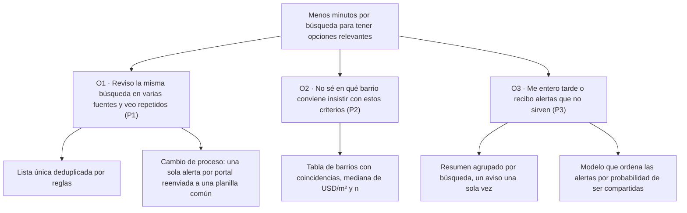

# Fase 1 · Análisis de mercado y competitividad

**Proyecto:** Precio y Entorno CABA · **Fecha de observación:** 9 de noviembre de 2026 · **Segmento:** departamentos en venta en CABA con precio de publicación en USD.

Este informe arma el mapa de competidores y el benchmark, y prioriza los problemas detectados con su evidencia. También deja preparada la validación con una inmobiliaria. Se elaboró con las skills `market-landscape-scan`, `competitive-research-snapshot`, `discovery-interview-prep`, `problem-statement`, `jobs-to-be-done`, `proto-persona`, `opportunity-solution-tree` y `positioning-statement`, integradas en un solo documento.

## Cómo leer las etiquetas

Cada afirmación importante lleva un estado y un código de evidencia (`E1`, `E2`…) que remite al [anexo](#9-anexo-de-evidencias).

| Etiqueta | Significado |
| --- | --- |
| **[Obs]** hecho observado | Lo vimos en la plataforma el 9/11/2026, sin iniciar sesión salvo que se indique. |
| **[Doc]** hecho documentado por el proveedor | Lo afirma el proveedor o quien publica el dato (centro de ayuda, informe, nota). No lo probamos. |
| **[Inf]** inferencia | Conclusión razonada a partir de hechos. Se indica la base. |
| **[Hip]** hipótesis | Supuesto sobre la inmobiliaria o el usuario que todavía no se validó. |
| **[NV]** no verificado | Intentamos verificarlo y no pudimos. Queda pendiente. |

**Límites de esta fase.** Usamos fuentes públicas y recorridos manuales acotados. No creamos cuentas, no enviamos formularios de alerta ni contactamos anunciantes. No ejecutamos extracciones. Todavía no hicimos ninguna entrevista ni prueba con una inmobiliaria: esos resultados figuran como pendientes.

---

## 1. Resumen ejecutivo

**Decisión de producto.** No competir como portal ni como alerta aislada. Posicionar Precio y Entorno CABA como una **herramienta de seguimiento de búsquedas de compradores** para quien gestiona varias búsquedas en una inmobiliaria. Antes de ampliar fuentes o sumar funciones, conviene probar con una inmobiliaria si **comparar barrios con los mismos criterios** y **recibir una lista única de avisos nuevos** reduce los minutos que lleva armar una lista de opciones relevantes.

**Por qué.**

1. **El mercado ya resuelve bien filtrar y avisar.** Zonaprop y Argenprop filtran por operación, barrio, ambientes, precio en USD y superficie cubierta, y ofrecen alertas por búsqueda. Argenprop permite crear una alerta solo con un correo, con frecuencia diaria o inmediata **[Obs, E1–E13]**. Una alerta más no alcanza como diferencial.
2. **Comparar barrios con los mismos criterios sigue siendo manual.** Ningún portal recorrido muestra, para el filtro de la usuaria, cuántos avisos coinciden en cada barrio junto con su precio por m². Hay que repetir la búsqueda barrio por barrio. Las guías de barrio son genéricas, y la de Zonaprop muestra una serie que termina en diciembre de 2024 **[Obs, E2, E3, E8]**.
3. **La oferta está repartida entre portales que no coinciden.** Con el mismo escenario, Zonaprop muestra 1.024 avisos y Argenprop 894 **[Obs, E1, E12]**. Ninguno de los dos elimina los duplicados entre portales. Roomix, que agrega fuentes, mostró el mismo aviso dos veces en la primera página **[Obs, E17]**. Por eso, quien sigue una búsqueda en más de un portal revisa avisos repetidos **[Inf]**.
4. **Las alertas existentes quedan atadas a un portal o a la cartera propia.** Cada portal avisa sobre sus propios avisos. Tokko Broker, el CRM inmobiliario relevado, envía coincidencias automáticas, pero solo de las propiedades cargadas en el CRM y de la red de colegas **[Doc, E19, E20]**.
5. **La cobertura es nuestra mayor debilidad.** Para el mismo escenario, la base local del prototipo tiene 59 coincidencias **[Obs, E28]**, cerca de un 6 % de lo que muestra Zonaprop. La captura de Zonaprop tomó hasta 50 avisos por barrio, por lo que esta cifra no mide el mercado. Igual, la diferenciación no puede apoyarse hoy en la cantidad de avisos.

**Qué sigue siendo hipótesis.** Todavía no está demostrado que la inmobiliaria revise varias fuentes por búsqueda, que compare barrios, que pierda tiempo con duplicados ni que pague por resolverlo. Por eso, **la primera hipótesis a probar** es esta: *para cada búsqueda activa, quien la gestiona revisa más de un canal y dedica una parte relevante de su tiempo a descartar avisos repetidos o incompatibles*. Si no se confirma, el producto pierde su motivo principal, y se puede comprobar en una entrevista de 30 minutos (sección 7).

---

## 2. Rubro, problema, usuarios y trabajo actual

### 2.1 Las tres preguntas de la profesora

| Pregunta | Respuesta | Estado |
| --- | --- | --- |
| **¿En qué industria competimos?** | En la intermediación inmobiliaria residencial de CABA, en el segmento de departamentos en venta publicados en USD. Dentro de ese rubro, en el software de apoyo comercial para inmobiliarias (portales, CRM y herramientas de búsqueda). | Definición del equipo ([brainstorming](brainstorming-capstone.md), [plan](plan-capstone.md)) |
| **¿Qué servicio queremos mejorar?** | El seguimiento de las búsquedas de compradores: pasar de los criterios de un comprador a una lista de avisos vigentes que valga la pena compartirle, y enterarse a tiempo de los nuevos. | [Hip] sobre el trabajo de la inmobiliaria |
| **¿Qué necesidad del mercado buscamos cubrir?** | Reunir opciones compatibles de varias fuentes sin repetir la búsqueda en cada portal, comparar barrios con los mismos criterios y saber qué aviso es realmente nuevo para cada búsqueda. | [Inf] a partir del benchmark; necesidad no confirmada en una inmobiliaria |

### 2.2 Quién usa, quién decide y quién paga

| Rol | Quién | Evidencia | Estado |
| --- | --- | --- | --- |
| **Usuaria operativa** | Quien gestiona varias búsquedas de compradores en la inmobiliaria: asesora comercial o corredora. | Los CRM del rubro organizan búsquedas por contacto (Tokko: «se basa en el contacto, no en la propiedad») **[Doc, E19]**. | [Hip] para la inmobiliaria piloto |
| **Quien decide la adopción** | Dueño, dueña o gerente de la inmobiliaria. | Las herramientas se contratan por inmobiliaria, con planes según la cantidad de usuarios **[Doc, E21]**. Las suscripciones a portales son un costo que discute el dueño **[Doc, E24]**. | [Inf] |
| **Quien paga** | La inmobiliaria, con una cuota mensual. Hipótesis de precio: USD 39 por mes ([pricing](pricing.md)). | Las inmobiliarias ya pagan abonos a portales y CRM **[Doc, E21, E24]**. Buscar en los portales es gratis para el comprador: no hizo falta iniciar sesión para filtrar **[Obs, E1, E10]**. | [Hip] sobre la disposición a pagar |
| **Beneficiario final** | El comprador, que recibe opciones más pertinentes y más rápido. No usa la herramienta ni la paga. | — | [Hip] |

### 2.3 Qué hay en el repositorio

| Componente | Estado | Fuente |
| --- | --- | --- |
| Preferencias, comparación de barrios por coincidencias, búsqueda guardada y una alerta por aviso nuevo y búsqueda, sin repetir alertas al reimportar un lote | **Implementado** y cubierto por pruebas | [README](../README.md), `tests/` |
| Catálogo de venta con 3.820 avisos válidos de Zonaprop, RE/MAX, Century 21, Migliorisi y Clarín, capturados con autorización el 7 y 8/11/2026 | **Implementado** | [README](../README.md), [EDA de avisos](eda-avisos.md) |
| Actualización automática cada 2 días y correo de alertas orquestado por Make con un Actor de Apify | **Implementado**. El 9/11/2026 generó una alerta real para la búsqueda guardada de Caballito **[Obs, E28]** | [README](operacion.md#4-actualización-automática) |
| Mapa del Delito como contexto, con período y unidad geográfica | **Implementado** | [EDA de delitos](eda-delitos.md) |
| Referencia de precio publicado por m² (MAE de 469 USD/m² en validación cruzada) | **Implementado como evaluación**. Su valor de uso no está probado | [Modelo](modelo.md) |
| Precio de USD 39 por mes, piloto de 14 días y protocolo de validación | **Propuesto** | [Pricing](pricing.md), [protocolo](validacion-inmobiliaria.md) |
| Ahorro de tiempo, utilidad de las alertas y disposición a pagar | **Requiere validación** | Sección 7 |

### 2.4 Proto-persona

> **Carla, la corredora con muchas búsquedas abiertas.** Proto-persona: perfil de trabajo construido con el repositorio y la investigación de escritorio. Todavía no hablamos con ninguna persona real, así que no hay citas: las frases son las que la entrevista tiene que confirmar o descartar.

- **Perfil.** Asesora comercial o corredora matriculada en una inmobiliaria chica o mediana de CABA. Atiende entre 5 y 20 búsquedas de compradores a la vez **[Hip]**. Trabaja con el celular y la computadora, y usa WhatsApp para comunicarse con sus clientes **[Hip]**.
- **Herramientas probables.** Uno o dos portales, en especial Zonaprop **[Doc: según un corredor de Caballito citado en la prensa, más del 80 % de sus clientes llega por Zonaprop, E24]**, alertas en el correo, WhatsApp, una planilla o un CRM como Tokko **[Hip]**.
- **Qué intenta lograr.** Mandar a cada comprador pocas opciones que encajen y antes que la competencia. Mostrarse como quien conoce el barrio **[Hip]**.
- **Dolores probables.** Repetir la misma búsqueda en varios portales, encontrar el mismo inmueble publicado por varias inmobiliarias, alertas mezcladas en el correo y avisos que ya no están disponibles **[Hip, apoyada en la fragmentación observada, E1, E12, E17]**.
- **Influencias y autoridad.** No decide la compra de herramientas. Influye con su experiencia de uso. La decisión es del dueño o la gerencia **[Hip]**.
- **Frases a confirmar en la entrevista.** «Cada mañana reviso las alertas de cada cliente», «Me llegan los mismos departamentos desde varios lados», «Al comprador le cuesta decidir entre dos barrios».

### 2.5 Trabajo actual, desde que entra una búsqueda hasta que se comparte un aviso

Reconstrucción hipotética, a validar en la entrevista (sección 7.2):

| Paso | Qué hace | Quién | Herramientas | Cómo decide si una opción es relevante | Estado |
| --- | --- | --- | --- | --- | --- |
| 1. Entra la búsqueda | Registra presupuesto, ambientes, superficie, barrios y requisitos (apto crédito, cochera, piso) | Asesora | WhatsApp, planilla o ficha del CRM | — | [Hip] |
| 2. Busca en la cartera propia y en la red | Revisa sus propiedades y las que comparten colegas | Asesora | CRM o red de colegas (Tokko permite buscar en la Red «previo acuerdo con el colega», E20) | Primero lo propio, por la comisión completa | [Doc] la función; [Hip] el orden |
| 3. Busca en portales | Repite los filtros en uno o más portales | Asesora | Zonaprop, Argenprop, Mercado Libre | Precio, m² cubiertos, estado, expensas y fotos | [Inf] |
| 4. Configura un seguimiento | Crea alertas por portal o guarda la búsqueda en el CRM | Asesora | Alertas de portal (con correo o cuenta), CRM | — | [Doc]/[Obs] las funciones; [Hip] el uso |
| 5. Filtra y descarta | Elimina repetidos, avisos vencidos e incompatibles | Asesora | Ojo y memoria, planilla | Experiencia propia y conocimiento del barrio | [Hip] |
| 6. Comparte | Envía 3 a 5 opciones al comprador | Asesora → comprador | WhatsApp, correo o ficha del CRM | Lo que el comprador aceptaría visitar | [Hip] |
| 7. Repite | Vuelve a revisar cuando llegan alertas | Asesora | Correo, notificaciones | Novedad frente a lo ya enviado | [Hip] |

### 2.6 Trabajo principal (JTBD)

> **Cuando** entra una búsqueda nueva o llega una novedad para una búsqueda activa, **quiero** reunir los avisos vigentes que cumplen sus criterios en los barrios donde tiene sentido buscar, sin repetidos, **para** enviarle al comprador pocas opciones relevantes antes de que lo haga otro.

- **Disparador.** Un comprador confirma sus criterios o llega un aviso nuevo **[Hip]**.
- **Resultado esperado.** Una lista corta y deduplicada de opciones compatibles, con el barrio comparado **[Hip]**.
- **Criterio de éxito.** Menos minutos por búsqueda para llegar a la lista, sin perder opciones que el método habitual sí encuentra, y alertas que la usuaria considere útiles y nuevas **[Hip; métricas del [protocolo](validacion-inmobiliaria.md)]**.
- **Trabajos sociales y emocionales.** Que el comprador perciba que la asesora conoce el barrio y llega primero. Evitar la sensación de que «se le pasó» un aviso **[Hip]**.

### 2.7 Enunciado del problema

> **Soy** una asesora inmobiliaria que gestiona varias búsquedas de compradores en CABA **y quiero** encontrar a tiempo los departamentos que les sirven, **pero** la oferta está repartida entre portales y redes que no coinciden y cada alerta llega por separado, **porque** cada herramienta organiza la información por portal o por cartera propia, no por búsqueda del comprador. **Por eso** siento que repito trabajo y que puedo enterarme tarde de una opción **[Hip; estructura de la skill `problem-statement`]**.

---

## 3. Fuentes y mapa del mercado

### 3.1 Inventario de fuentes de investigación competitiva

Estas fuentes sirven para entender el mercado. **No** forman parte de los datasets analíticos del capstone.

| Fuente | Qué permite observar | Qué queda fuera de su alcance |
| --- | --- | --- |
| Listados públicos de Zonaprop, Argenprop y Mercado Libre (E1–E14) | Filtros, conteos de oferta visible, orden, pasos para crear alertas y requisitos de sesión | La entrega real de las alertas (requiere cuenta o correo), datos de demanda y avisos ya vendidos |
| Fichas de aviso de Zonaprop (E7) | Antigüedad del aviso, visualizaciones y nivel del anunciante | Agregados de demanda por barrio. Una ficha no representa al mercado |
| Index Zonaprop, septiembre 2026 (E9) | Precio medio publicado por m² por barrio, variación y avisos con baja de precio | Precios de cierre. Usa solo los avisos de Zonaprop |
| Centro de ayuda y página de planes de Tokko Broker (E19–E21) | Funciones documentadas del CRM: búsquedas por contacto, envío automático y red de colegas | Uso real, precios (la página dice «Actualizando») y calidad de las coincidencias |
| Roomix (E16–E18) | Agregador emergente: alertas, USD/m² por aviso y por barrio, vistas de mapa | Su comparativa es material de un competidor. Su deduplicación no se verificó |
| Cabaprop (E22, E23) | Portal del Colegio Inmobiliario de la Ciudad, solo con corredores matriculados | No se recorrió el escenario completo |
| Colegio de Escribanos de CABA (E25) | Escrituras de compraventa y con hipoteca por mes en toda la Ciudad | Desagregación por barrio o por tipo de inmueble |
| Prensa sectorial (E24, E26, E27) | Señales cualitativas: tensiones por precios de portales, propiedad de los grupos y dispersión de datos en inmobiliarias | Fuentes anónimas o patrocinadas. Se usan solo como señal |
| Properati (E15) | Nada. Respondió «Access Denied» (HTTP 401) en la portada y en la búsqueda | Todo. Queda **[NV]** |

### 3.2 Fuentes analíticas del capstone (separadas)

| Fuente | Unidad | Período y geografía | Uso en este informe |
| --- | --- | --- | --- |
| **Catálogo autorizado de avisos vigentes** (`inmobiliarias-autorizadas`: Zonaprop, RE/MAX, Century 21, Migliorisi y Clarín) | Aviso de departamento en venta, **precio de publicación** en USD | Capturas del 7 al 9/11/2026, 48 barrios. Zonaprop aporta hasta 50 avisos por barrio | Solo para medir la cobertura propia frente a los portales (E28). No es una muestra proporcional del mercado |
| **Mapa del Delito de CABA** | Hecho **registrado** | 1/1/2024–31/12/2025, por barrio y comuna, con coordenadas | **Contexto**, no un puntaje de seguridad. No se usa para comparar competidores. Ninguna de las pantallas recorridas mostraba delitos registrados, pero su utilidad para la inmobiliaria es una pregunta abierta (sección 7.2) |

### 3.3 Cómo se segmenta el mercado según quien compra la herramienta

- **Inmobiliaria chica o independiente que publica en portales, sin CRM o con planilla.** Paga portales y resuelve el seguimiento a mano **[Hip]**. Es el segmento más probable para el piloto.
- **Inmobiliaria con CRM y red de colegas** (por ejemplo, Tokko). Ya automatiza las coincidencias dentro de su cartera y su red **[Doc, E19, E20]**. El diferencial tendría que estar en los avisos de fuera de la red.
- **Franquicias** (RE/MAX, Century 21). Tienen sistemas y redes internas **[Hip]**. Hoy son fuentes del catálogo, no clientes objetivo.
- **Comprador particular que busca por su cuenta.** Lo atienden los portales y agregadores como Roomix **[Obs, E16]**. Es una extensión B2C ([pricing de búsqueda personal](pricing-busqueda-personal.md)), no el segmento principal.
- **Diferencia entre cómo se vende y qué se necesita.** Los portales venden **visibilidad a quien publica**: destacados y abonos para anunciantes **[Obs: «Super destacado» en los avisos, E1; Doc: abonos, E24]**. La usuaria necesita trabajar **del lado de la demanda**, es decir, sobre las búsquedas de sus compradores **[Inf]**. Ese desajuste es el espacio donde podría entrar el producto.

### 3.4 Mapa de competidores y sustitutos

| # | Alternativa | Tipo | A quién sirve | Qué trabajo resuelve | Dónde aparece en el recorrido | Por qué alguien la seguiría usando | Señal de evidencia |
| --- | --- | --- | --- | --- | --- | --- | --- |
| 1 | **Zonaprop** | Portal directo | Compradores y anunciantes | Buscar, filtrar, ver en mapa, ordenar por «Recientes» o «Bajaron de precio», crear alertas | Pasos 3, 4 y 7 | Mayor oferta visible, y los clientes llegan por ahí | 1.024 avisos en el escenario **[Obs, E1]**. Forma parte del grupo QuintoAndar desde 2021 **[Doc, E26]** |
| 2 | **Argenprop** | Portal directo | Compradores y anunciantes | Buscar, filtrar por moneda, por tipo de anunciante y por estado, alerta con un correo | Pasos 3, 4 y 7 | Alerta sin cuenta e inmediata | 894 avisos en el escenario **[Obs, E12]** |
| 3 | **Mercado Libre Inmuebles** | Portal directo | Compradores y anunciantes | Buscar y «Guardar esta búsqueda» | Pasos 3 y 4 | Masividad y cuenta ya existente | 1.239 departamentos de 2 ambientes en Caballito, sin filtro de precio **[Obs, E14]** |
| 4 | **Roomix** | Agregador emergente | Compradores, con una sección «Soy inmobiliario» | Unificar fuentes, USD/m² por aviso y por barrio, alertas por correo o WhatsApp | Pasos 3, 4 y 7 | Agrega varios portales y avisa por WhatsApp | Dice tener 373.188 avisos activos deduplicados al 30/07/2026 **[Doc, E18]** |
| 5 | **Tokko Broker** | CRM adyacente | Inmobiliarias | Guardar búsquedas por contacto y enviar coincidencias por correo, red de colegas, difusión en portales | Pasos 1, 2, 4 y 6 | Es el sistema de registro de la inmobiliaria | Envío automático documentado **[Doc, E19]**. Pertenece al mismo grupo que Zonaprop **[Doc, E21]** |
| 6 | **Cabaprop** | Portal gremial adyacente | Compradores. Solo publican corredores matriculados | Buscar oferta de matriculados del Colegio | Paso 3 | Respaldo del Colegio | Según una nota de 2024, más de 30.000 propiedades en venta **[Doc, E23]** |
| 7 | **Método habitual** | Sustituto | La propia inmobiliaria | Portales, alertas en el correo, WhatsApp, planilla y memoria | Todo el recorrido | No cuesta extra y ya está aprendido | Los datos de clientes suelen estar dispersos entre Excel, WhatsApp y correo **[Doc, señal débil, E27]** |
| 8 | **Properati** | Portal directo | Compradores y anunciantes | — | Paso 3 | — | Inaccesible el 9/11/2026 **[NV, E15]** |

### 3.5 Dinámica del mercado

- **Dónde está el dinero.**
  - Las inmobiliarias pagan a los portales por visibilidad. En 2024, inmobiliarias y martilleros denunciaron que un abono de Zonaprop pasó de cerca de $280.000 a $1.500.000 entre julio de 2023 y marzo de 2024 **[Doc: nota de prensa con fuentes mayormente anónimas, E24]**.
  - El mismo grupo controla el portal con más oferta visible y un CRM de inmobiliarias. La página de planes de Tokko muestra el logo de QuintoAndar y un contacto con dominio navent.com **[Doc, E21, E26]**. **[Inf]** Una integración entre ambos podría absorber parte del espacio del producto.
- **Dónde está el movimiento.**
  - En septiembre de 2026 hubo 6.612 escrituras de compraventa en CABA, un 5,5 % menos que un año antes. Las escrituras con hipoteca fueron 1.256, un 15,5 % menos. De enero a septiembre suman 48.195 escrituras, un 2,7 % menos que en el mismo período de 2025 **[Doc, E25]**.
  - Según el Index Zonaprop, el precio medio publicado fue de USD 2.484/m² en septiembre de 2026, con una suba de 1,4 % en el año. El 27 % de los avisos bajó su precio en los últimos seis meses, con un descuento promedio de 5,9 % **[Doc, E9; son precios de publicación, no de cierre]**.
- **Consolidación o fragmentación.** La oferta se concentra en pocos portales, pero aparecen alternativas: un portal gremial (Cabaprop) y agregadores con IA (Roomix). Para quien busca, la oferta sigue repartida entre plataformas **[Inf, E1, E12, E17, E22]**.
- **Cambios tecnológicos o regulatorios.**
  - Búsqueda en lenguaje natural y alertas por WhatsApp (Roomix, **[Doc, E16]**). En nuestra prueba, el refinamiento con IA no cambió los resultados **[Obs, E17]**.
  - El acceso automatizado a los portales está restringido: los términos de Zonaprop limitan las herramientas externas y Properati bloqueó el acceso **[Doc, [README](../README.md); Obs, E15]**. Esto hace que las fuentes del producto dependan de autorizaciones.

### 3.6 Espacios libres y zonas sin demanda

| Hueco aparente | ¿Oportunidad o zona sin demanda? |
| --- | --- |
| **Seguimiento por búsqueda del comprador con avisos de cualquier fuente** | **Oportunidad condicional.** Los portales avisan solo sobre su propia oferta y Tokko sobre la cartera y la red **[Doc, E19, E20]**. *Lectura contraria:* la inmobiliaria quizás prefiera no ofrecer avisos de otras inmobiliarias para no compartir comisión, y por eso use la red de colegas «previo acuerdo» **[Hip]**. Hay que preguntarlo. |
| **Comparar barrios con los criterios del comprador** | **Oportunidad condicional.** Ningún portal lo muestra **[Obs]**. *Lectura contraria:* el comprador puede llegar con el barrio ya decidido, y entonces nadie necesita la comparación **[Hip]**. |
| **Contexto de delitos registrados** | **Zona dudosa.** No lo vimos en los competidores **[Obs]**. *Lectura contraria:* la inmobiliaria puede evitarlo para no espantar al comprador. El protocolo ya pregunta si resulta «contraproducente» ([validación](validacion-inmobiliaria.md#6-entrevista-final-20-minutos)). |

---

## 4. Benchmark

### 4.1 Escenario de prueba y selección

**Escenario ilustrativo.** Operación: venta. Tipo: departamento. Barrios: Caballito y Almagro. Moneda: USD. Presupuesto: hasta USD 150.000. Ambientes: 2. Superficie cubierta: desde 40 m². Fecha de observación: 9 de noviembre de 2026, sin iniciar sesión.

**Alternativas del benchmark (5) y motivo de la elección.**

| Elegida | Motivo |
| --- | --- |
| Zonaprop | Mayor oferta visible y canal principal de las inmobiliarias **[Obs, Doc, E1, E24]** |
| Argenprop | Segundo portal, con la alerta más simple **[Obs, E13]** |
| Roomix | Es la competencia más directa en la propuesta: une fuentes, muestra el precio por m² y avisa por WhatsApp **[Doc, E16]** |
| Tokko Broker | Representa al CRM con envío automático de coincidencias, el sustituto más cercano dentro de la inmobiliaria **[Doc, E19]** |
| Método habitual | Es la alternativa que la usuaria realmente usaría. Se evalúa como hipótesis |

**Fuera del benchmark detallado.** Mercado Libre: no se pudo aplicar el escenario por barrio (la página respondió HTTP 400), así que solo se registra lo observado **[NV, E14]**. Cabaprop: es adyacente y no se recorrió en detalle. Properati: no estaba accesible **[NV, E15]**.

**Diferencias entre plataformas que impiden aplicar los mismos filtros.**

- **Superficie.** Zonaprop y Argenprop filtran por superficie cubierta. Zonaprop muestra la superficie **total** en la tarjeta y la cubierta solo en la ficha **[Obs, E1, E7]**. En Roomix no encontramos el filtro de superficie cubierta. La búsqueda en lenguaje natural no aplicó el escenario y el conteo no cambió **[Obs, E17]**.
- **Barrios.** Zonaprop y Argenprop usan los 48 barrios. Roomix suma subbarrios no oficiales, como «Caballito Norte» o «Almagro Sur» **[Obs, E17]**.
- **Tipo de aviso.** La lista de Zonaprop mezcla avisos individuales con emprendimientos («Departamentos desde USD 139.000», 8 unidades) **[Obs, E4]**. Por eso los conteos no son comparables uno a uno.
- **Moneda.** En Argenprop, el filtro de moneda arranca en «Indistinto». Para el escenario elegimos «Dólares» **[Obs, E12]**.

### 4.2 Matriz comparativa con los seis ejes

Los conteos miden **oferta observada en cada plataforma**, no el mercado. Incluyen avisos duplicados y, en algunos casos, emprendimientos.

| Eje | Zonaprop | Argenprop | Roomix | Tokko Broker (CRM) | Método habitual | Precio y Entorno (prototipo) |
| --- | --- | --- | --- | --- | --- | --- |
| **1. Precios y disponibilidad** | Precio publicado y expensas en la tarjeta. Orden por menor precio o «Bajaron de precio». Ficha con antigüedad del aviso **[Obs, E6, E7]** | Precio, expensas y filtro de moneda **[Obs, E12]** | Precio, expensas y **USD/m² por aviso** **[Obs, E17]** | Precios de la cartera y la red **[Doc, E20]** | Depende del portal usado **[Hip]** | Precio publicado y mediana por barrio para el filtro. No da de baja avisos que desaparecen **[Doc, [README](../README.md)]** |
| **2. Oferta y variedad** | 1.024 avisos (Caballito 556, Almagro 468) **[Obs, E1–E3]** | 894 (Caballito 470, Almagro 424) **[Obs, E10–E12]** | 3.072 departamentos en venta en Caballito, sin filtro **[Obs, E17]**. No medido para el escenario **[NV]** | Cartera propia y red de colegas **[Doc, E19, E20]** | Suma de lo que se revise **[Hip]** | **59** (Almagro 36, Caballito 23) **[Obs, E28]** |
| **3. Demanda y tendencias** | Visualizaciones por aviso, orden «Más vistos» e Index mensual **[Obs, E6, E7; Doc, E9]** | No observado | Índice propio de precios **[Doc, E16]** | Reporte de «patrones de búsqueda» de los contactos **[Doc, E19]** | Conocimiento del corredor **[Hip]** | Sin indicador. Requiere búsquedas guardadas reales. Hoy hay 1 **[Obs, E28]** |
| **4. Calidad y valoraciones** | «Nivel» del anunciante, calificaciones y botón para denunciar el aviso **[Obs, E7]** | Filtro por tipo de anunciante (dueño o inmobiliaria) **[Obs, E12]** | Detector de estafas y deduplicación **[Doc]**. Duplicado visible **[Obs, E17]** | No observado | Criterio propio **[Hip]** | Validación de campos y aviso de posibles duplicados entre fuentes, sin eliminarlos **[Doc, [EDA](eda-avisos.md)]** |
| **5. Ubicación y cobertura** | Vista de mapa y guía de barrio con serie de USD/m² hasta 12/2024 **[Obs, E8]**. Cubre todo el país | Vista de mapa **[Obs]** | Mapa, vista dividida y subbarrios **[Obs, E17]** | La zona definida en la búsqueda **[Doc, E19]** | Variable **[Hip]** | 48 barrios, capas del entorno y delitos registrados como contexto **[Doc, [README](../README.md)]** |
| **6. Experiencia del usuario** | Filtros con URL compartible. Iniciar sesión obligatorio para alertar **[Obs, E5]** | Alerta sin cuenta **[Obs, E13]** | Lenguaje natural y WhatsApp **[Doc, E16]** | Ficha de contacto, firma y plantilla de la inmobiliaria **[Doc, E19]** | Manual **[Hip]** | Prototipo local. No está validado con usuarias |

### 4.3 Recorrido de las cuatro tareas

| Tarea | Zonaprop | Argenprop | Roomix | Tokko Broker | Método habitual |
| --- | --- | --- | --- | --- | --- |
| **1. Aplicar preferencias** | 5 controles: barrios, operación, tipo, ambientes y precio. Superficie cubierta en «Más filtros». Sin sesión **[Obs]**. Fricción: la tarjeta muestra m² totales | Barrio, operación, tipo y precio con moneda. Superficie cubierta en «Más filtros». Sin sesión **[Obs]** | Barrio por URL. El refinamiento en lenguaje natural no se aplicó **[Obs]**. **[NV]** el filtro de superficie cubierta | En la solapa «Buscador» de la ficha del contacto **[Doc]** | Se repite en cada portal **[Inf]** |
| **2. Comparar barrios con los mismos criterios** | Con varios barrios da un solo total. Para comparar hay que hacer una búsqueda por barrio (2 búsquedas) y no muestra USD/m² de las coincidencias **[Obs]** | Igual: total combinado y una búsqueda por barrio **[Obs]** | USD/m² por barrio, pero sin los filtros del comprador. Dos valores distintos para Caballito en el mismo sitio (2.425 y 2.316) **[Obs]** | No documentado **[NV]** | Manual o no se hace **[Hip]** |
| **3. Guardar la búsqueda** | «Crear alerta» pide iniciar sesión **[Obs]** | «Crear alerta» con correo y frecuencia, sin cuenta (formulario no enviado) **[Obs]** | Requiere cuenta y verificar el canal **[Doc]** | Ícono de disquete en la ficha del contacto. Guarda la búsqueda **[Doc]** | Una alerta por portal y comprador **[Inf]** |
| **4. Cómo se avisa una coincidencia** | **[NV]**: requiere cuenta. La app promete notificaciones de las búsquedas guardadas **[Doc, E26b]** | Correo, diario o inmediato **[Obs: opciones del formulario]**. **[NV]** la entrega | Correo o WhatsApp, diario o semanal. «Urgente» solo por WhatsApp **[Doc]** | Correo automático **al cliente** con la firma de la inmobiliaria, y notificación a la asesora **[Doc]**. Solo sobre la cartera y la red | Correos de cada portal por separado **[Inf]** |

**Para Tokko y el método habitual.** Tokko automatiza bien las tareas 3 y 4 dentro de la cartera y la red. Depende de que alguien cargue las propiedades y revise los filtros: su propia ayuda advierte que el envío es inmediato y que conviene revisar los filtros **[Doc, E19]**. El método habitual resuelve todas las tareas con intervención humana. **No medimos** cuántos minutos lleva: es la línea de base que debe aportar la prueba (sección 7.4).

### 4.4 Lectura del benchmark

| Paso del flujo | ¿Lo resuelve bien el mercado? | Evidencia |
| --- | --- | --- |
| Preferencias | **Sí.** Los filtros cubren el escenario completo | **[Obs, E1, E12]** |
| Comparación de barrios | **No.** Hay que buscar barrio por barrio, sin precio por m² de las coincidencias | **[Obs, E1–E3, E10–E12, E17]** |
| Búsqueda guardada | **Sí, dentro de cada plataforma.** No hay una búsqueda única para varias fuentes | **[Obs, E5, E13; Doc, E19]** |
| Alerta por aviso nuevo | **Parcial.** Avisa por portal o por cartera, sin deduplicar entre fuentes | **[Doc, E16, E19; Obs, E17]** |

**Riesgos competitivos.** (1) Roomix ya ofrece la propuesta «varias fuentes, una alerta» al comprador y tiene una sección para inmobiliarias **[Doc, E16]**. (2) Zonaprop y Tokko comparten grupo y podrían cruzar las búsquedas del CRM con todo el portal **[Inf, E21, E26]**.

---

## 5. Problemas priorizados

Ninguno está confirmado en una inmobiliaria. Lo observado son **fricciones en las plataformas**. La **necesidad** se confirma recién con la sección 7.

### P1 · La misma búsqueda hay que seguirla en varias fuentes que no coinciden y repiten avisos

- **A quién afecta.** A la asesora que gestiona varias búsquedas.
- **Dónde aparece.** En los pasos 3, 5 y 7 del recorrido.
- **Evidencia.** Con el mismo escenario, Zonaprop muestra 1.024 avisos y Argenprop 894 **[Obs, E1, E12]**. En el catálogo del proyecto hay 221 posibles duplicados entre fuentes **[Doc, [EDA](eda-avisos.md)]**. Roomix mostró un aviso duplicado pese a deduplicar **[Obs, E17]**. Los datos de las inmobiliarias suelen estar repartidos entre planillas, WhatsApp y correo **[Doc, señal débil, E27]**.
- **Consecuencia.** Tiempo de revisión y riesgo de mandar dos veces el mismo inmueble o de perder uno **[Inf]**.
- **Explicación alternativa a investigar.** La inmobiliaria usa un solo portal (la prensa cita «más del 80 %» de clientes por Zonaprop, E24) o la red de colegas. En ese caso, la fragmentación no le pesa.

### P2 · Comparar barrios con los criterios del comprador requiere repetir búsquedas

- **A quién afecta.** A la asesora cuando orienta al comprador. Al comprador cuando decide dónde visitar.
- **Dónde aparece.** En el paso 3, antes de configurar el seguimiento.
- **Evidencia.** Los portales dan un total combinado y no muestran la mediana de USD/m² de las coincidencias. La guía de barrio de Zonaprop es genérica y su serie termina en 12/2024. Roomix muestra USD/m² por barrio sin los filtros del comprador y con dos cifras distintas para Caballito **[Obs, E1–E3, E8, E17]**.
- **Consecuencia.** Más búsquedas por comprador o recomendaciones de barrio basadas en la intuición **[Inf]**.
- **Explicación alternativa a investigar.** El comprador ya trae el barrio decidido, o la asesora conoce tan bien la zona que la comparación no le aporta.

### P3 · Las alertas llegan por portal o por cartera, no por búsqueda del comprador

- **A quién afecta.** A la asesora, que recibe y filtra las alertas.
- **Dónde aparece.** En los pasos 4 y 7.
- **Evidencia.** Zonaprop pide una cuenta para alertar. Argenprop pide un correo por alerta **[Obs, E5, E13]**. Tokko envía coincidencias, pero solo de la cartera y la red **[Doc, E19, E20]**. Ninguna alerta distingue un aviso nuevo de uno republicado en otra fuente **[Inf]**.
- **Consecuencia.** Alertas mezcladas en el correo y novedades que llegan tarde o repetidas **[Hip]**.
- **Explicación alternativa a investigar.** La inmobiliaria no busca fuera de su cartera y su red, por razones de comisión. Entonces el problema real sería de captación, no de seguimiento.

---

## 6. Árbol de oportunidades y posicionamiento

### 6.1 Árbol de oportunidades

**Resultado medible.** Reducir la **mediana de minutos por búsqueda** necesarios para llegar a una lista de opciones relevantes, sin bajar la cobertura de relevantes frente al método habitual. La línea de base se mide con la prueba de la sección 7.4. Hoy no está medida.

| Oportunidad | Solución o cambio de proceso | Tipo | Supuesto más riesgoso | Prueba de bajo costo | Problema |
| --- | --- | --- | --- | --- | --- |
| **O1** | **Lista única deduplicada.** Une avisos con igual barrio y ambientes, m² cubiertos ±2 y precio ±3 %. Mantiene el enlace a cada fuente | **Reglas** | Que la asesora hoy revise más de una fuente por búsqueda | En la entrevista, contar las fuentes revisadas en la última búsqueda. Después, armar a mano la lista deduplicada para 3 búsquedas y medir minutos frente a su método (concierge) | P1 |
| **O1** | **Cambio de proceso sin producto.** Una alerta por portal y búsqueda, reenviada a una planilla común | Proceso | Que el reenvío no agregue más trabajo del que ahorra | Probar una semana con 2 búsquedas y registrar minutos | P1 |
| **O2** | **Tabla comparativa de barrios** con coincidencias, mediana de USD/m² publicada y cantidad de avisos que la respaldan. Ya está en el prototipo | **Reglas** | Que elegir barrio forme parte del trabajo de la asesora | Mostrar la tabla impresa **después** de reconstruir su método y preguntar si la usaría con un comprador concreto | P2 |
| **O3** | **Resumen agrupado por búsqueda,** un aviso una sola vez. Ya está en el prototipo con Make | **Reglas** | Que las alertas útiles sean también **nuevas** para la asesora | Dos semanas de alertas marcadas como `util`, `no_util` o `ya_conocida` (protocolo, tarea B) | P3 |
| **O3** | **Ordenar las alertas con un modelo.** Aprende de las valoraciones `util` y `no_util` y usa como variable la diferencia con la referencia de precio por m² (MAE de 469 USD/m²) | **Modelo** | Que las reglas no alcancen y que haya suficientes valoraciones para entrenar | Con las valoraciones de la tarea B, comparar la precisión de las reglas con un ordenamiento simple por desvío de precio. Seguir adelante solo si mejora la proporción de alertas útiles en el primer tercio de la lista | P3 |

**Prueba de concepto elegida.** O1 con O2 en una sola prueba (sección 7.4). Son reglas que ya existen en el prototipo o se implementan en poco tiempo, atacan el supuesto más riesgoso y se pueden medir en minutos. El modelo de O3 queda para cuando haya valoraciones reales.

### 6.2 Posicionamiento provisional

> **Para** quienes gestionan varias búsquedas de compradores de departamentos en venta en CABA desde una inmobiliaria,
> **que necesitan** reunir y priorizar opciones nuevas de distintas fuentes sin repetir la búsqueda en cada portal,
> **Precio y Entorno CABA**
> **es una** herramienta de seguimiento de búsquedas
> **que** compara barrios con los criterios de cada comprador y avisa una sola vez por cada aviso nuevo compatible.
>
> **A diferencia de** combinar alertas de portales con una planilla y WhatsApp, **Precio y Entorno CABA** organiza la información por búsqueda del comprador y no por portal.

| Diferenciación | Respaldo |
| --- | --- |
| Comparar barrios con los mismos criterios, con mediana y n | **Respaldada por el benchmark:** ningún portal recorrido lo ofrece **[Obs]** |
| Una búsqueda guardada que cruza varias fuentes autorizadas | **Respaldada a medias:** los portales avisan solo sobre lo suyo **[Obs, Doc]**, pero Roomix ya agrega fuentes **[Doc]**. Nuestra cobertura es baja **[Obs, E28]** |
| Menos minutos y alertas útiles | **Depende de la validación.** No medido |
| Contexto de delitos registrados | **Depende de la validación.** Puede ser útil, indiferente o contraproducente |

---

## 7. Validación con una inmobiliaria

### 7.1 Plan de entrevistas

- **Objetivo.** Validar los problemas (P1–P3) y medir el método habitual antes de mostrar el prototipo. Metodología: reconstrucción de una búsqueda real reciente, con preguntas sobre hechos pasados y no sobre deseos.
- **A quién.** Una o dos personas que gestionen búsquedas de compradores de departamentos en venta en CABA. En lo posible, también el dueño o la gerencia, para la parte de adopción y pago.
- **Restricciones.** Acceso limitado: entre 1 y 3 entrevistas antes del 24/11. Los resultados son orientativos y no se extrapolan.
- **Datos.** Nada de nombres, teléfonos ni correos de compradores, propietarios o anunciantes. Se registran solo criterios y conteos.

### 7.2 Guion de 25 minutos

**Apertura (2 min).**
«Gracias por el tiempo. Estamos investigando cómo trabajan las inmobiliarias las búsquedas de compradores. No venimos a venderte nada. Nos sirve que nos cuentes lo que hacés, incluso lo que no funciona. No vamos a anotar datos de clientes. ¿Te parece bien que tomemos notas?»

**Contexto (3 min).**
1. ¿Cuántas búsquedas de compradores de departamentos en venta tenés activas hoy? ¿Cuántas entraron el último mes?
   - *Repregunta:* ¿Quién más del equipo las gestiona?

**Reconstrucción de la última búsqueda (12 min).**

2. Pensá en la última búsqueda de compra que empezaste. ¿Qué te pidió el comprador? Solo criterios: presupuesto, ambientes, superficie y barrios.
3. Contame paso a paso qué hiciste después. ¿Dónde buscaste primero?
   - *Repregunta:* ¿Y después? ¿Cuántas pantallas o herramientas abriste?
   - *Evitar:* «¿No te resulta lento usar varios portales?»
4. ¿Cuánto tiempo te llevó tener una primera lista para mandarle? ¿Cómo lo sabés? ¿Lo podés estimar con lo que hiciste ese día?
5. ¿Cuántos avisos miraste y cuántos descartaste? ¿Por qué descartaste los últimos tres?
   - *Repregunta:* ¿Alguno estaba repetido o ya no estaba disponible?
6. ¿Cuáles compartiste y por qué esos? ¿Por dónde los enviaste?
7. ¿Hablaron de barrios? ¿El comprador ya tenía el barrio decidido o lo ayudaste a elegir? ¿Cómo lo hiciste?
   - *Evitar:* «¿Te serviría comparar barrios?»

**Novedades y alertas (5 min).**

8. Desde que empezaste esa búsqueda, ¿cómo te enteraste de las opciones nuevas? Mostrame, si querés, dónde te llegan.
   - *Repregunta:* ¿Cuántas alertas recibiste esta semana? ¿Cuántas te sirvieron? ¿Alguna llegó repetida desde otro portal?
9. ¿Buscás solo en tu cartera y en la de colegas, o también avisos de otras inmobiliarias en portales? ¿Por qué?
   - *Repregunta:* ¿Qué pasa con la comisión cuando el inmueble es de otra inmobiliaria?
10. ¿La última vez que se te pasó una opción, qué pasó?

**Herramientas y costos (2 min).**

11. ¿Qué herramientas pagan hoy para esto? ¿Quién decidió contratarlas? ¿Qué dejaron de usar y por qué?
    - *Evitar:* «¿Pagarías por algo que…?»

**Cierre (1 min).**
«Te resumo lo que entendí: [resumen]. ¿Es así? ¿Hay alguien más del equipo con quien convenga hablar?»

**Después de la entrevista, aparte (5 a 10 min, opcional).** Demo del prototipo y pedido para la prueba de la sección 7.4. La demo no forma parte de la evidencia del problema.

**Qué confirmaría, matizaría o refutaría cada problema.**

| Problema | Lo confirma | Lo matiza | Lo refuta |
| --- | --- | --- | --- |
| P1 | Revisa 2 o más fuentes y menciona repetidos espontáneamente | Revisa 2 fuentes pero sin repetidos relevantes | Usa una sola fuente o solo la red |
| P2 | Ayudó al comprador a elegir barrio en la última búsqueda | Lo hace a veces, por intuición | El comprador siempre trae el barrio |
| P3 | Se enteró tarde de una opción o tiene alertas desordenadas | Tiene alertas ordenadas, pero en varios portales | El CRM le resuelve las novedades |

### 7.3 Ficha de registro (sin datos personales)

| Campo | Ejemplo de formato |
| --- | --- |
| ID de entrevista | ENT-01 |
| Fecha y duración | 2026-11-__ · __ min |
| Rol de la persona | asesora / corredora / dueño o gerente |
| Búsquedas activas (n) | __ |
| Criterios de la última búsqueda | Venta · __ amb · hasta USD __ · desde __ m² · barrios: __ |
| Fuentes revisadas (lista y cantidad) | __ |
| Minutos hasta la primera lista (relato) | __ (estimado / registrado) |
| Avisos mirados / descartados / compartidos | __ / __ / __ |
| Motivos de descarte | repetido · no disponible · precio · estado · otro |
| ¿Comparó barrios? ¿Cómo? | sí / no · __ |
| Canal de novedades y alertas de la semana | __ alertas · __ útiles · __ repetidas |
| ¿Busca fuera de la cartera y la red? | sí / no · motivo |
| Herramientas pagas y quién decide | __ |
| Frases textuales clave (sin nombres) | «__» |
| Problemas: P1 / P2 / P3 | confirma · matiza · refuta |
| Sorpresas | __ |

### 7.4 Diseño de la prueba: método habitual frente al prototipo

- **Unidades.** Entre 4 y 6 búsquedas reales de venta en USD, cargadas solo con sus criterios.
- **Diseño.** Cada búsqueda se resuelve con los dos métodos, alternando el orden entre búsquedas. En el segundo método se usan criterios equivalentes y la misma fecha de captura. Cada intento tiene un tope de 20 minutos.
- **Criterio de relevancia acordado antes de empezar.** Una opción es relevante si la asesora la enviaría al comprador. Se marca sin saber de qué fuente salió: la lista se presenta mezclada y sin logos.
- **Registro.** Se usa la [planilla del protocolo](plantillas/registro-validacion.csv): minutos hasta la lista, opciones encontradas, relevantes, repetidas y no disponibles. Para las alertas, durante 2 semanas: `util`, `no_util` (con motivo) y `ya_conocida`.
- **Métricas.**
  - Ahorro de tiempo: mediana de (minutos con el método habitual − minutos con el prototipo).
  - Cobertura: opciones relevantes del prototipo / opciones relevantes del método habitual.
  - Precisión de las alertas: útiles / revisadas.
  - Novedad: útiles que no eran `ya_conocida` / útiles.

**Reglas de decisión, fijadas antes de la prueba.**

| Resultado | Lectura | Decisión |
| --- | --- | --- |
| Ahorro mediano de 5 minutos o más por búsqueda **y** cobertura de 80 % o más | Apoya la hipótesis. Con 40 revisiones por mes y USD 12/h, 5 minutos cubren la cuota de USD 39 ([pricing](pricing.md)) | Pasar al piloto pago |
| Ahorro de 5 minutos o más, pero cobertura menor al 80 % | El flujo sirve, pero faltan fuentes | Priorizar sumar catálogos autorizados antes que funciones nuevas |
| Ahorro menor a 5 minutos | El problema no pesa o el prototipo no lo resuelve | Volver a la entrevista. Revisar si P1 existe |
| Alertas útiles, pero casi todas `ya_conocida` | El valor está en ahorrar revisión, no en la novedad | Cambiar el mensaje del pitch |
| La asesora no compara barrios | P2 no aplica | Quitar la comparación del pitch para este segmento |

**Resultados:** pendientes hasta hacer la entrevista y la prueba.

---

## 8. Señales sobre alquiler (posible extensión)

- Roomix centra sus alertas y precios en el alquiler, con frecuencia urgente por WhatsApp **[Doc, E16]**.
- El Index Zonaprop informa un alquiler medio de $898.154 por mes para un 2 ambientes en septiembre de 2026 **[Doc, E9]**.
- Según el informe de Cabaprop con la UTN, el 35 % de las alertas de búsqueda de sus usuarios correspondía a alquiler de largo plazo. Es una muestra de usuarios del portal, no del mercado **[Doc, E23]**.
- El prototipo ya tiene una base de alquiler con 3.271 avisos **[Doc, [Arquitectura](arquitectura.md#5-base-de-datos)]**. Queda fuera del segmento principal.

---

## 9. Anexo de evidencias

Todas las observaciones se hicieron el **9/11/2026** en un navegador de escritorio, sin iniciar sesión, salvo que se indique. Los enlaces son públicos.

| ID | Fuente y enlace | Fecha | Afirmación que respalda | Estado |
| --- | --- | --- | --- | --- |
| E1 | [Zonaprop · escenario en Caballito y Almagro](https://www.zonaprop.com.ar/departamentos-venta-caballito-almagro-2-ambientes-mas-40-m2-cubiertos-menos-150000-dolar.html) | 9/11/2026 | 1.024 avisos con el escenario. Tarjetas con «Super destacado» y m² totales | Obs |
| E2 | [Zonaprop · Caballito](https://www.zonaprop.com.ar/departamentos-venta-caballito-2-ambientes-mas-40-m2-cubiertos-menos-150000-dolar.html) | 9/11/2026 | 556 avisos | Obs |
| E3 | [Zonaprop · Almagro](https://www.zonaprop.com.ar/departamentos-venta-almagro-2-ambientes-mas-40-m2-cubiertos-menos-150000-dolar.html) | 9/11/2026 | 468 avisos | Obs |
| E4 | [Zonaprop · sin filtro de superficie](https://www.zonaprop.com.ar/departamentos-venta-caballito-almagro-2-ambientes-menos-150000-dolar.html) | 9/11/2026 | 1.823 avisos. Mezcla avisos con emprendimientos («Departamentos desde USD 139.000», 8 unidades) | Obs |
| E5 | Zonaprop · botón «Crear alerta» en E3 | 9/11/2026 | Abre «Iniciar sesión» con correo, Google, Facebook o Apple | Obs |
| E6 | Zonaprop · menú «Ordenar» y «Ver mapa» en E3 | 9/11/2026 | Orden por Relevantes, Menor precio, Recientes, Mayor precio, Más vistos y Bajaron de precio. Vista de mapa | Obs |
| E7 | [Zonaprop · ficha de un aviso de Almagro](https://www.zonaprop.com.ar/propiedades/clasificado/veclapin-hermoso-2-amb-muy-luminoso-con-balcon-y-cochera-60245477.html) | 9/11/2026 | «Publicado hace 45 días», «440 visualizaciones», «Nivel 4» del anunciante con calificaciones, opción de denunciar y 40 m² cubiertos | Obs |
| E8 | [Zonaprop · guía de barrio de Almagro](https://www.zonaprop.com.ar/barrios/capital-federal/almagro.html) | 9/11/2026 | Rango de precios del barrio, promedio de venta y serie de USD/m² de jul/2024 a dic/2024 | Obs |
| E9 | [Index Zonaprop CABA, septiembre 2026 (PDF)](https://www.zonaprop.com.ar/blog/wp-content/uploads/2026/10/INDEX_CABA_REPORTE_2026-09.pdf) | Creado el 5/10/2026 | USD 2.484/m² (+0,3 % en el mes, +1,4 % en 2026). 2 ambientes de 50 m²: USD 131.757. Caballito: 2.428 USD/m². 27 % de avisos con baja de precio, con 5,9 % de descuento. Alquiler de 2 ambientes: $898.154. Fuente: avisos publicados en Zonaprop | Doc |
| E10 | [Argenprop · Caballito](https://www.argenprop.com/departamentos/venta/caballito/2-ambientes/dolares-hasta-150000?desde-40-m2-cubiertos&solo-ver-dolares) | 9/11/2026 | 470 avisos | Obs |
| E11 | [Argenprop · Almagro](https://www.argenprop.com/departamentos/venta/almagro/2-ambientes/dolares-hasta-150000?desde-40-m2-cubiertos&solo-ver-dolares) | 9/11/2026 | 424 avisos | Obs |
| E12 | [Argenprop · Almagro o Caballito](https://www.argenprop.com/departamentos/venta/almagro-o-caballito/2-ambientes/dolares-hasta-150000?desde-40-m2-cubiertos&solo-ver-dolares) | 9/11/2026 | 894 avisos. Filtro de moneda (Indistinto, Pesos, Dólares), tipo de anunciante, estado y «Ver mapa». Orden por Destaque, Menor precio, Mayor precio y Más nuevos | Obs |
| E13 | Argenprop · botón «Crear alerta» en E12 | 9/11/2026 | Formulario con resumen de la búsqueda, correo y frecuencia «Diaria» o «Inmediata». No pide cuenta. No se envió | Obs |
| E14 | [Mercado Libre · 2 ambientes en venta en Capital Federal](https://inmuebles.mercadolibre.com.ar/departamentos/venta/2-ambientes/capital-federal/) | 9/11/2026 | 19.690 resultados. Caballito 1.239 y Almagro 861. Filtros de precio y superficie cubierta. Botón «Guardar esta búsqueda», visto con una sesión ya iniciada en el navegador y sin usarlo. Las URL por barrio respondieron HTTP 400 o una página vacía | Obs / NV |
| E15 | [Properati](https://www.properati.com.ar/) | 9/11/2026 | «Access Denied» (HTTP 401) en la portada y en la búsqueda | NV |
| E16 | [Roomix · alertas de propiedades](https://roomix.ai/alertas-de-propiedades) | 9/11/2026 | Alertas diarias o semanales por correo o WhatsApp, y urgentes solo por WhatsApp. Requiere cuenta y verificación. Sección «Soy inmobiliario» e índice propio | Doc |
| E17 | [Roomix · departamentos en venta en Caballito](https://roomix.ai/buscar/comprar/departamentos/en-caballito) | 9/11/2026 | 3.072 avisos y US$2.316/m² en esta página, contra U$S 2.425/m² en la [página de CABA](https://roomix.ai/buscar/comprar/departamentos/en-capital-federal). Un aviso repetido (Gaona 1100) en la primera página. El refinamiento en lenguaje natural no cambió el conteo. Subbarrios no oficiales. USD/m² por aviso | Obs |
| E18 | [Roomix · comparativa ZonaProp vs ArgenProp vs Roomix](https://roomix.ai/blog/zonaprop-vs-argenprop-vs-roomix-2026) | Publicada el 26/4/2026, actualizada el 1/8/2026 | Contadores: ZonaProp 706.435, ArgenProp 550.122 y Roomix 373.188 (deduplicados al 30/07/2026). Material de un competidor | Doc |
| E19 | [Tokko Broker · guardar una búsqueda para un contacto](https://intercom.help/tokko-broker/es/articles/432308-como-guardar-una-busqueda-para-un-contacto-en-tokko-broker) | 23/12/2025 | Búsqueda guardada por contacto. Con el «auto-envío», cada propiedad que ingresa y coincide se envía por correo al cliente y se notifica a la asesora. Advierte que el envío es inmediato | Doc |
| E20 | [Tokko Broker · buscar en la Red](https://dudas.tokkobroker.com/es/articles/432292-como-buscar-en-la-red-tokko-broker) | 29/5/2020 | Consultar y comercializar propiedades de colegas, previo acuerdo | Doc |
| E21 | [Tokko Broker · planes y precios](https://www.tokkobroker.com/es-ar/planes-y-precios) | Sin fecha, leído el 9/11/2026 | Planes de 1 a 15 usuarios y de 15 a 300 propiedades. Precios «Actualizando». Los portales pagos requieren contratación externa. Logo de QuintoAndar y contacto con dominio navent.com | Doc |
| E22 | [Cabaprop](https://cabaprop.com.ar/) | 9/11/2026 | «Todas las inmobiliarias de la Ciudad en un solo lugar». Solo corredores matriculados del Colegio Inmobiliario | Obs |
| E23 | [iProfesional · Cabaprop](https://www.iprofesional.com/realestate/415881-cabaprop-nueva-plataforma-para-buscar-departamentos-baratos) | 28/10/2024 | Más de 30.000 propiedades en venta. Alertas de búsqueda: 55 % compraventa y 35 % alquiler. Fuente interesada | Doc |
| E24 | [iProfesional · aumentos de Zonaprop](https://www.iprofesional.com/economia/405449-inmobiliarias-en-alerta-denuncian-a-zonaprop-por-aumentos-abusivos) y [nota previa](https://www.iprofesional.com/negocios/403287-por-que-hay-alerta-en-el-sector-inmobiliario-por-el-avance-de-zonaprop) | 8/5/2024 y 4/4/2024 | Abono de cerca de $280.000 (7/2023) a $1.500.000 (3/2024). Un corredor de Caballito: más del 80 % de los clientes llega por Zonaprop. Fuentes anónimas | Doc (señal) |
| E25 | [Colegio de Escribanos de CABA · escrituras de septiembre 2026](https://www.colegio-escribanos.org.ar/?p=144949) | 22/10/2026 | 6.612 compraventas (−5,5 % interanual), 1.256 con hipoteca (−15,5 %), 48.195 de enero a septiembre (−2,7 %). Monto medio de unos US$120.106 | Doc |
| E26 | [El Cronista · QuintoAndar compra Zonaprop](https://www.cronista.com/infotechnology/it-business/el-gigante-brasileno-quintoandar-compra-zonaprop-y-va-por-el-talento-argentino) | 23/12/2021 | QuintoAndar adquirió las operaciones inmobiliarias de Navent, incluido Zonaprop | Doc |
| E26b | [Zonaprop en App Store](https://apps.apple.com/us/app/zonaprop/id531131585) | Leído el 9/11/2026 | Descripción de la app: guardar búsquedas y recibir notificaciones con novedades de la búsqueda | Doc |
| E27 | [iProfesional · CRM para inmobiliarias](https://www.iprofesional.com/realestate/452164-crm-para-inmobiliarias-por-que-se-pierden-ventas-y-como-mejorar-gestion-clientes) | 10/4/2026 | Datos de clientes repartidos entre Excel, WhatsApp, correos y agendas. Nota que promociona un CRM, con cifras sin fuente | Doc (señal débil) |
| E28 | Base local `data/local/real.sqlite3` y `data/local/actualizaciones.jsonl` | 9/11/2026 | 3.820 avisos. 59 coinciden con el escenario: Almagro 36 (Migliorisi 13, Zonaprop 11, RE/MAX 6, Century 21 6) y Caballito 23 (Century 21 9, Zonaprop 7, RE/MAX 6, Migliorisi 1). Hay 1 búsqueda guardada. La actualización del 9/11 generó 1 alerta real | Obs |

**Pendientes de verificación.** Entrega real de las alertas de Zonaprop, Argenprop, Mercado Libre y Roomix. Escenario completo en Mercado Libre, Roomix y Cabaprop. Properati completo. Precios de Tokko. Propiedad actual de Argenprop: las fuentes secundarias no coinciden y no la usamos.

---

## 10. Síntesis oral (90 segundos)

> Investigamos el mercado de departamentos en venta en CABA desde la mirada de quien gestiona búsquedas de compradores en una inmobiliaria. Recorrimos el mismo escenario en los portales: 2 ambientes en Caballito y Almagro, hasta 150 mil dólares y desde 40 metros cubiertos. También relevamos Roomix, el CRM Tokko Broker y el método manual.
>
> Encontramos tres cosas. Primero, filtrar y crear alertas ya está resuelto: Zonaprop y Argenprop lo hacen bien, y Argenprop avisa con solo un correo. Segundo, comparar barrios con los criterios del comprador no lo resuelve nadie: hay que repetir la búsqueda barrio por barrio y ningún portal muestra el precio por metro de esas coincidencias. Tercero, la oferta está repartida: el mismo escenario da 1.024 avisos en Zonaprop y 894 en Argenprop, sin eliminar repetidos, y Tokko avisa solo sobre la cartera propia y la red de colegas.
>
> Lo que sigue siendo hipótesis es que la inmobiliaria revise varias fuentes por búsqueda, que pierda tiempo con duplicados y que pague por resolverlo. También reconocemos nuestra debilidad: con ese escenario, nuestra base tiene 59 avisos.
>
> Para comprobarlo, vamos a entrevistar a una inmobiliaria sobre su última búsqueda real, sin mostrar el producto al principio. Después vamos a comparar su método con el prototipo en cuatro a seis búsquedas, midiendo minutos, opciones relevantes y alertas útiles. Si ahorramos cinco minutos por búsqueda sin perder opciones, pasamos a un piloto pago. Si no, ajustamos el producto antes de agregar funciones.
