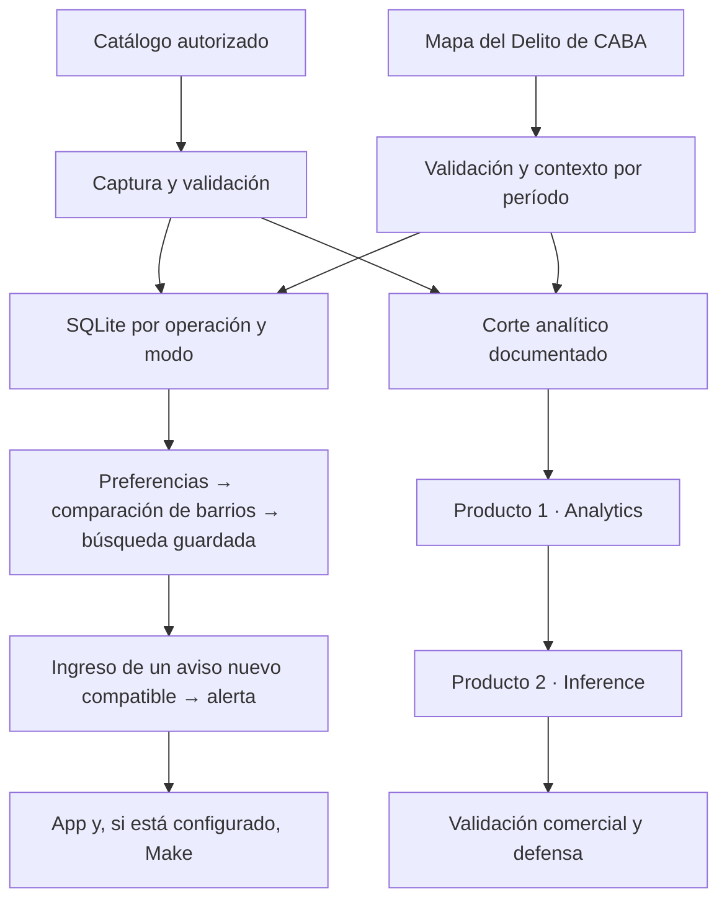

# Flujo de trabajo de Precio y Entorno CABA

Guía operativa del proyecto y de la entrega del capstone. Los detalles de implementación están en [Arquitectura](arquitectura.md) y los responsables, hitos y evidencias en el [plan de entrega](plan-capstone.md).



## 1. Preparar el entorno y las fuentes

Ejecutá desde la raíz del proyecto en PowerShell. Los insumos geográficos locales deben estar en `data/raw/badata-entorno/` y `data/raw/badata-poi/`. Si faltan, consultá el [inventario de fuentes y capas](datos.md).

```powershell
python -m venv .venv
.\.venv\Scripts\python.exe -m pip install -r requirements.txt
.\.venv\Scripts\python.exe -m precio_entorno.entorno
.\.venv\Scripts\python.exe -m precio_entorno.api
```

Abrí [la interfaz web local](http://127.0.0.1:8000). En otra terminal, ejecutá `.\.venv\Scripts\python.exe -m streamlit run app.py` para importar archivos o simular la actualización. Las dos interfaces usan las mismas bases locales.

- **Avisos.** Registrá permiso, catálogo, operación, fecha de captura y procedencia. El producto admite venta y alquiler. El corte analítico principal usa departamentos en venta publicados en USD de un catálogo autorizado. El catálogo consolidado conserva prefijos de origen en los IDs.
- **Delitos registrados.** Usá el CSV oficial local del Mapa del Delito de CABA. Registrá edición, período y cobertura. Las capas urbanas y puntos de interés complementan el producto y sirven como controles en los experimentos del modelo.
- **Credenciales y acceso.** Guardá permisos y secretos fuera de Git. Excluí contactos de anunciantes de capturas, exportaciones y evidencias. Si hace falta una extracción paga, comprobá el acceso y el tope antes de ejecutarla. El piloto admite hasta 50 avisos de Caballito y Almagro con hasta USD 5 en una sola cuenta. El presupuesto total es USD 25, con hasta USD 5 por cuenta. Conservá IDs de corrida, costos informados y resultados de calidad.

## 2. Capturar, validar e importar

1. Partí de una captura autorizada existente o generá una nueva en una carpeta de `data/raw/`. Los conectores guardan el lote inmobiliario y el registro de ejecución. Las exportaciones de Apify se adaptan al contrato de importación. El [README](operacion.md#2-capturas) distingue el piloto original del conector de Zonaprop usado para las capturas posteriores. Ante una interrupción, consultá el registro y el dataset existente antes de repetir una corrida paga.
2. En Streamlit, elegí **Comprar** o **Alquilar**, seleccioná **Datos reales** e importá el CSV o JSON con el catálogo correspondiente. El ETL valida el ID estable, enlace, fecha, barrio, moneda, precio, superficie cubierta y ambientes. Normaliza los barrios y reporta faltantes, inválidos, incorporados, descartados y duplicados. El [contrato de datos](operacion.md#formato-del-catálogo) enumera los campos y límites.
3. Cargá el CSV de delitos en la base real que corresponda. El archivo válido reemplaza el contexto anterior de esa base y se identifica por nombre y SHA-256. Los resúmenes suman la cantidad registrada y muestran período y unidad geográfica. Un barrio y período sin filas válidas se informa como cobertura no observada.
4. Revisá el resultado de la ingesta. Venta y alquiler tienen bases, catálogos, búsquedas y alertas propios. En alquiler se conserva la moneda publicada y las expensas se informan aparte cuando están disponibles. Las bases de demo contienen únicamente datos ficticios.

## 3. De las preferencias a la alerta

1. **Preferencias.** Elegí operación, presupuesto, superficie mínima y ambientes. En alquiler elegí también moneda. Seleccioná las capas de entorno que quieras ver.
2. **Comparación.** Revisá cuántos avisos cumplen los filtros y su mediana de precio publicado. Abrí la ficha de un barrio para consultar los avisos y las capas. Los delitos registrados se presentan como contexto con período y escala. La [metodología del mapa](mapa-registros.md) explica la cobertura y los radios alrededor de avisos con pin preciso.
3. **Búsqueda guardada.** Elegí un barrio y guardá la búsqueda. La búsqueda registra barrio, presupuesto, superficie mínima, ambientes y moneda. Las capas elegidas sirven para explorar el entorno.
4. **Aviso nuevo.** Importá un lote posterior. Cada ID nuevo compatible genera una alerta por búsqueda. La reimportación del lote conserva las alertas existentes. Las capturas posteriores actualizan el precio y su historial. Un aviso que reaparece se reactiva y se compara otra vez con las búsquedas. Un barrido completo puede pasar un aviso ausente a `no_visto` y luego a `baja`, con el freno de seguridad documentado en [ETL y vigencia](etl.md#4-bis-vigencia-avisos-vendidos-reservados-o-retirados). El catálogo local puede conservar avisos cuya disponibilidad aún no se verificó.
5. **Comprobación.** En modo demo, compará Caballito, Almagro y Villa Crespo, guardá una búsqueda en Caballito e importá el lote ficticio nuevo. Verificá que aparezca la alerta y repetí la importación para comprobar que el total de alertas se mantenga.

## 4. Actualización y notificación

La ruta local se inicia con [scripts/actualizar.cmd](../scripts/actualizar.cmd), que llama a `precio_entorno.actualizar` para venta y alquiler. El proceso captura avisos recientes de fuentes autorizadas, importa el lote y registra el resultado en `data/local/actualizaciones.jsonl`. La programación documentada corre cada dos días con la sesión de Windows iniciada.

Si el webhook de Make está configurado, recibe el resumen, las alertas agrupadas por búsqueda y el estado `ok`, `parcial` o `error`. El [escenario de Make](arquitectura.md#8-make) registra corridas, avisa de fallos y deriva las alertas a correo y planilla. El cliente reintenta un envío fallido una vez y deja el resultado en el historial. Ante un incidente, revisá primero el registro de la captura, luego la importación y finalmente el estado del webhook. La [prueba de las tres rutas](operacion.md#5-alertas-por-correo-con-make-y-apify) usa datos ficticios y envía al webhook configurado.

También existe un [Actor de alertas](../precio_entorno/actor_alertas.py) con [entrada definida](../.actor/input_schema.json). Recibe las búsquedas en su configuración, guarda IDs vistos por operación en el almacenamiento de Apify y usa la primera corrida como línea de base. Las corridas siguientes devuelven las coincidencias nuevas agrupadas por búsqueda en el dataset, con el resumen en `OUTPUT`. Su implementación en el repositorio documenta una ruta distinta de la tarea local.

## 5. Producto 1 · Analytics

1. Congelá el corte de avisos en venta en USD y la edición del Mapa del Delito. Registrá fechas, hashes o versiones, filtros, unidad de cada tabla y conteos antes y después de limpiar. Separá el volumen operativo del tamaño de la muestra analítica. El plan pide 700–2.000 filas válidas y unas diez variables interpretables por dataset.
2. Generá [EDA de avisos](eda-avisos.md), [EDA de delitos](eda-delitos.md) y el paquete para el [notebook de Colab](../notebooks/eda_oportunidades.ipynb). Usá el corte de la entrega como entrada y documentá el diccionario, incluidos origen, tipo, unidad y manejo de nulos.

   ```powershell
   python -m precio_entorno.eda_avisos data/raw/inmobiliarias-20261107
   python -m precio_entorno.eda_delitos
   python -m precio_entorno.eda_colab
   ```

3. Mostrá oferta, precios por m² y contexto geográfico. Informá el tamaño de muestra, los faltantes y la unidad de análisis. Para completar la entrega, documentá Pearson, Spearman y gráficos para relaciones no lineales. Vinculá cada hallazgo con una decisión de búsqueda o de negocio.
4. En la demo de Analytics, seguí un lote de Apify a Make hasta la salida analítica y el dashboard. Conservá el registro de una ejecución válida, una entrada inválida o fallo controlado y una reimportación sin alertas duplicadas. La integración de entrega se verifica por separado del webhook de alertas.

## 6. Producto 2 · Inference

1. Reproducí la [evaluación del modelo](modelo.md) sobre el corte congelado. El objetivo es el precio **publicado** en USD por m² cubierto. Compará la mediana de comparables, el modelo inmobiliario y la variante con delitos en la misma partición agrupada. Reportá MAE en prueba y validación cruzada, cobertura, placebo y alcance de generalización. Documentá aparte la sensibilidad por radio. Los resultados registrados no muestran una mejora robusta atribuible a los delitos.
2. Para cerrar Inference, persistí el modelo y las transformaciones con versión y esquema de entrada. Probá un aviso nuevo y otro inválido. La demo debe cargar el artefacto guardado, estimar la referencia de publicación sin reentrenar y mostrar resultado, unidad, versión y MAE de evaluación en el dashboard. El repositorio ya contiene el pipeline de evaluación. El [plan](plan-capstone.md) registra el empaquetado y la vista de inferencia como entregables pendientes.
3. El Actor comercial previsto debe ofrecer documentación por GET y aceptar por POST `operation=analytics` o `operation=inference`. Para la defensa, adjuntá parámetros, ejemplos, errores, límites y mediciones de costo, CU, memoria y duración. El Actor de alertas cubre la detección de coincidencias y tiene su propio contrato.

## 7. Seguimiento, validación y entrega

| Hito de noviembre de 2026 | Evidencia que se espera |
| --- | --- |
| 3 y 5/11 | Reflexión, ideas y criterio de elección, equipo, ficha, pitch y devolución de Diana. |
| 10/11 | ETL, diccionario, correlaciones, métricas y ensayo del dashboard. |
| 12/11 | Demo de Analytics con fallo controlado, registro de los tres pedidos reales de Diana y acuerdo de alcance de Inference. |
| 17 y 20/11 | Diseño y devolución técnica, evaluación reproducible y demo de Inference con un aviso nuevo. |
| 24/11 | Actor comercial, presupuesto, validación, ROI, repositorio y defensa de seis minutos más dos de preguntas. |

- **Trabajo del equipo.** DS lleva datos, EDA y modelo. SE lleva integración, automatización y pruebas. BIZ lleva métricas, propuesta, presupuesto y validación. El líder canaliza los pedidos y acuerdos con la cliente.
- **Trello.** El [tablero privado](https://trello.com/b/V0xpPjUo/precio-y-entorno-caba-capstone) sigue las [13 tarjetas del documento](tablero-trello.md). Usá **Backlog** para lo postergado, **Por hacer** para trabajo listo, **En curso** al tomar la tarea, **Bloqueado** cuando falte una dependencia y **Hecho** al verificar la evidencia. Adjuntá el enlace al informe, corrida o resultado al cerrar cada tarjeta.
- **Validación comercial.** Aplicá el [protocolo con una inmobiliaria](validacion-inmobiliaria.md). Registrá tiempo ahorrado, utilidad de alertas, costos y disposición a pagar. Separá inversión inicial, operación mensual, datos observados y supuestos de ROI. Documentá los pedidos, la decisión comercial y el próximo paso con evidencia real.
- **Verificación local.** Corré `python -m unittest discover -s tests -v` y guardá el resultado con la versión usada. El repositorio de entrega reúne código, manual, resultados autorizados y límites de interpretación. Los precios representan importes de publicación. Los delitos representan hechos registrados en el período y unidad indicados.

