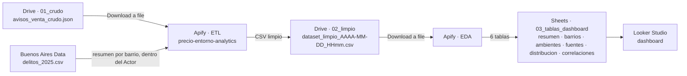

# Pipeline Analytics: Drive → Apify → Drive → Apify → Sheets → Looker Studio

Make orquesta todo el recorrido. Lee los datos crudos de Google Drive, le pide a Apify el ETL, guarda en Drive un único CSV limpio, le pide a Apify el EDA y carga sus tablas en una planilla de Google, de donde lee el dashboard de Looker Studio.

Probado de punta a punta el 14 de noviembre de 2026: la ejecución de Make terminó en SUCCESS y la planilla quedó con la corrida de las 15:08 UTC.

El 17/11/2026 a las 22:12 UTC se volvió a correr, con el tratamiento de nulls ([tratamiento-nulls.md](tratamiento-nulls.md)). El CSV de Drive es `02_limpio/dataset_limpio_2026-11-17_1912.csv`, con 3.806 filas, 25 columnas y 0 nulls. El Actor necesita subir también `descripcion.py`, que usa `importing.py`. `tests/test_actor_analytics.py` controla que no falte ningún módulo y que ninguno sea de entrenamiento.



## Piezas

| Pieza | Dónde | Qué hace |
| --- | --- | --- |
| Carpeta en Drive | [Precio y Entorno CABA - Pipeline Analytics](https://drive.google.com/drive/folders/1pjfJG1SbhkOUAdpCSmbQU_yGT7HSaZad) | `01_crudo`, `02_limpio`, `03_tablas_dashboard` |
| Datos crudos | `01_crudo/avisos_venta_crudo.json` | 4.007 filas de la captura consolidada del 8/11 (inmobiliarias autorizadas, Clarín y Zonaprop), sin contactos de anunciantes |
| | `01_crudo/delitos_2025_crudo.csv.gz` | Copia comprimida del Mapa del Delito 2025 (17 MB sin comprimir, SHA-256 `1ed67c33…`) |
| Actor | Apify, cuenta 2, `peerless_anorthite~precio-entorno-analytics` (privado) | `operacion: etl`, `eda` e `inferencia`. Código: [`analytics/main.py`](../precio_entorno/analytics/main.py) (solo entrada y salida de Apify) y un módulo por etapa en [`precio_entorno/analytics/`](../precio_entorno/analytics/) |
| Escenario | Make, «Precio y Entorno CABA - Pipeline Analytics» (7037544), a pedido | 9 módulos y 9 operaciones por corrida. Se crea con [`make_pipeline.py`](../precio_entorno/make_pipeline.py) |
| Planilla | [Precio y Entorno CABA - Tablas del dashboard](https://docs.google.com/spreadsheets/d/1_3s-zpZAvhCGF1nu8WlSihdXZiIwQayb6C8Qk6NWLuM/edit) | Una pestaña por tabla. Make la vacía y la vuelve a escribir en cada corrida, así Looker Studio no pierde la conexión |
| Dashboard | [Looker Studio: Precio y Entorno CABA - Dashboard Analytics](https://lookerstudio.google.com/reporting/5057b183-22bb-4370-8c23-a47387a9d6f1) (privado, credenciales de lector) | Página 1: indicadores, top 10 de barrios por USD/m² y tabla de barrios. Página 2: histograma, USD/m² por ambientes, correlaciones, dispersión de delitos contra USD/m² y nota de fuentes. Página 4: referencias del modelo (inferencia) |

**Por qué los delitos viajan dentro del Actor.** El CSV oficial pesa 17 MB y Make Free no mueve archivos de más de 5 MB. El Actor no descarga nada: los datos le llegan solo por la entrada, con el SDK. `apify_analytics subir` resume el archivo local por barrio (48 filas: delitos, robos y hurtos, % con arma y comuna, más período y calidad del archivo) después de verificar su SHA-256 contra el documentado en [datos.md](datos.md), y lo deja en la carpeta del Actor como `referencias/delitos_barrio.json`. Con el resumen, el CSV limpio sale idéntico al que daba el archivo completo (comprobado con los 3.806 avisos el 23/11/2026). El resultado de la verificación queda en `delitos_sha256_esperado` del reporte. En Drive queda la copia cruda como referencia. Para otro año de delitos, se reemplaza el archivo local y se vuelve a subir el Actor.

## Escenario de Make, módulo por módulo

| # | Módulo | Entrada → salida |
| --- | --- | --- |
| 1 | Google Drive › Download a file | `avisos_venta_crudo.json` |
| 2 | HTTP › Make a request (POST `run-sync`) | `{"operacion":"etl","contenidoBase64":…}` → CSV limpio (registro OUTPUT del Actor) |
| 3 | Google Drive › Upload a file | `02_limpio/dataset_limpio_AAAA-MM-DD_HHmm.csv`. Queda un CSV por corrida, como historial |
| 4 | Google Drive › Download a file | Ese mismo CSV: el EDA lee lo que quedó en Drive |
| 5 | HTTP › Make a request (POST `run-sync`) | `{"operacion":"eda",…}` → cuerpo de `values:batchUpdate` |
| 6 | Google Sheets › Make an API call | `values:batchClear` de las 6 pestañas del EDA y de `predicciones` |
| 7 | Google Sheets › Make an API call | `values:batchUpdate` con las tablas |
| 8 | HTTP › Make a request (POST `run-sync`) | `{"operacion":"inferencia",…}` sobre el CSV del paso 4 → cuerpo de `values:batchUpdate` con las referencias |
| 9 | Google Sheets › Make an API call | `values:batchUpdate` en la pestaña `predicciones` |

Captura del escenario: [`docs/img/make/escenario-pipeline-analytics.png`](img/make/escenario-pipeline-analytics.png).

Si el Actor falla, `run-sync` responde con error y Make corta el flujo antes de tocar Drive o la planilla. Make avisa por correo los escenarios con error.

**Correrlo para la demo.** En Make, abrir el escenario y tocar **Run once**. No hace falta activarlo. Tardaba 1 a 2 minutos, con unos 70 s del ETL para bajar y validar los 17 MB de delitos. Con el resumen dentro del Actor, ese paso ya no descarga nada; el tiempo nuevo se mide en la próxima corrida. Después, en Looker Studio, usar **Actualizar datos**.

**Programarlo.** El plan Free de Make admite 2 escenarios activos, y hoy están activos «Búsquedas» y «Alertas con Apify». Para que el pipeline corra solo (por ejemplo, cada lunes) hay que desactivar otro escenario o pasar a un plan pago. Desde la API, `make_pipeline correr` necesita el escenario activo.

**Costos medidos el 14/11.** ETL: USD 0,003 por corrida. EDA: USD 0,0003. Construir el Actor costó unos USD 0,006. En Make son 9 operaciones por corrida desde el 20/11, de las 1.000 mensuales del plan Free. La inferencia cuesta menos de USD 0,004 por corrida: el dataset guarda solo los avisos para revisar primero, porque Apify cobra cada ítem escrito (con los 3.806 costaba unos USD 0,02).

## Qué hace cada operación

**ETL** ([`analytics/ETL.py`](../precio_entorno/analytics/ETL.py)):
1. Valida cada aviso con las reglas del importador de la app: barrio de CABA, precio en USD dentro de rango, superficie, ambientes y USD/m² plausibles.
2. Deja una fila por aviso, la de la captura más reciente.
3. Marca los posibles duplicados entre fuentes, con la misma regla del modelo: barrio, ambientes, m² y precio redondeados.
4. Suma el contexto delictivo del barrio: delitos registrados, robos y hurtos y porcentaje con arma, sin siniestros viales, con `periodo_delitos` y `unidad_delitos = barrio`.
5. Trata los nulls y verifica que no quede ninguno ([tratamiento-nulls.md](tratamiento-nulls.md)):
   - Superficie total faltante → la cubierta (`superficie_total_imputada`).
   - Expensas → se elimina la columna, por faltar en el 58 %; queda `expensas_informadas`.
   - Sin pin → mediana de los pines del barrio (`ubicacion_origen`).

   Si queda algún null, el Actor falla y Make no escribe en Drive.

Corrida del 14/11: 4.007 filas leídas, 201 descartadas y 3.806 avisos en 48 barrios, con 444 posibles duplicados.

**EDA** ([`analytics/EDA.py`](../precio_entorno/analytics/EDA.py)):

| Pestaña | Una fila por | Para el gráfico |
| --- | --- | --- |
| `resumen` | corrida | Indicadores: avisos, barrios, mediana USD/m², descartes, período de delitos |
| `barrios` | barrio | Barras de USD/m², mapa de burbujas (`ubicacion` = lat,lon), dispersión de delitos contra USD/m² |
| `ambientes` | 1, 2, 3, 4, 5 o más | Barras de USD/m² y precio por ambientes |
| `fuentes` | fuente | Composición del catálogo y completitud de lo publicado, antes de imputar (pin, expensas, superficie total) |
| `distribucion` | tramo de 500 USD/m² | Histograma |
| `correlaciones` | variable | Pearson (lineal) y Spearman (monotónica) contra USD/m², con n. Latitud y longitud, solo con pines publicados |

Cada tabla queda además como CSV en el almacén de la corrida en Apify. La de barrios también queda en el dataset, que se exporta a CSV, Excel o JSON desde Apify Console.

**Inferencia** ([`analytics/inference.py`](../precio_entorno/analytics/inference.py) y [`analytics/tooling_business.py`](../precio_entorno/analytics/tooling_business.py)):

1. Lee el modelo ya entrenado de su propia carpeta (`modelo/modelo.joblib` y `modelo/evaluacion.json`), que `apify_analytics subir` arma con el artefacto de `data/processed/inferencia/`. No lo crea, no lo baja de un almacén, no entrena ni reajusta. Controla que su SHA-256 coincida con la evaluación y que scikit-learn sea la 1.7.2 del entrenamiento.
2. Pasa el CSV limpio a las variables del modelo ([`analytics/preprocessing.py`](../precio_entorno/analytics/preprocessing.py)). Solo entra venta en USD. Las coordenadas y la superficie total que el ETL imputó para el dashboard vuelven a quedar como faltantes, igual que en el entrenamiento.
3. Estima la referencia de publicación en USD/m² y en USD para cada aviso.
4. Compara el USD/m² publicado con la referencia. A más de 20 % por debajo es «debajo de la referencia» (revisar primero), a más de 20 % por encima es «encima» y el resto es «cerca». El 20 % es del orden del error del modelo: el 70 % de la prueba quedó dentro de ±20 %.

OUTPUT trae el cuerpo de `values:batchUpdate` para una pestaña `predicciones`. La tabla completa queda en `predicciones.csv`; el dataset guarda solo los avisos debajo de la referencia (566), y el resumen en `RESUMEN_INFERENCIA`. El resumen informa el error que aplica: con los campos del CSV limpio, sin distancias ni rasgos de entorno, el MAE de prueba es 616 USD/m², contra 443 del modelo completo y 627 de la mediana de comparables. Es una referencia de publicación, no una tasación.

Subido y probado en Apify el 20/11/2026 (modelo `1d4013afcf906e8c`). Con `probar`, el ETL dio el mismo CSV limpio, byte a byte, que la corrida del 17/11, y las cinco pestañas de datos del EDA salieron idénticas. Ese mismo día Make corrió los 9 módulos desde el editor (Success, 9 operaciones, 92 s) y la pestaña `predicciones` quedó con 3.806 referencias: 566 debajo de la referencia (14,9 %), 2.225 cerca y 1.015 encima. Construcción vigente: `8MaakMhxgfEpbSggG`.

## Dashboard en Looker Studio

Looker Studio es gratis y lee la planilla directamente: cada vez que Make la reescribe, el dashboard muestra los datos nuevos.

El informe ya está armado: [Precio y Entorno CABA - Dashboard Analytics](https://lookerstudio.google.com/reporting/5057b183-22bb-4370-8c23-a47387a9d6f1). Se completó el 17/11/2026 siguiendo el método de la skill `looker-studio-bigquery`: una página por pregunta, indicadores antes que el detalle, y la frescura y las aclaraciones visibles.

### Ficha de entrega

| | |
| --- | --- |
| **Audiencia** | Docentes del capstone e inmobiliaria que gestiona búsquedas de compradores |
| **Pregunta que responde** | Dónde está la oferta de departamentos en venta en CABA, cuánto se pide por m² y qué contexto delictivo tiene cada barrio |
| **Fuente** | Planilla «Precio y Entorno CABA - Tablas del dashboard»: 6 pestañas que escribe el EDA del Actor y la pestaña `predicciones` que escribe la inferencia. Una fila por barrio, por ambientes, por fuente, por tramo de USD/m² o por variable |
| **Frescura** | A pedido: cada **Run once** del escenario de Make reescribe la planilla. Frescura de los datos en Looker: 15 minutos |
| **Responsable** | Equipo del capstone. Make avisa por correo si una corrida falla |
| **Aclaraciones** | Precios de publicación, no tasaciones ni precios de cierre. Delitos registrados en 2025 por barrio como contexto, no como causa |

| Página | Pregunta | Gráficos |
| --- | --- | --- |
| **Panorama de precios** | ¿Cuánto se pide y dónde es más caro? | Indicadores: avisos, mediana USD/m², barrios y mediana de precio. Tabla de los 48 barrios ordenada por mediana USD/m², barras con los barrios más caros y pie con aclaraciones |
| **Mapa de barrios** | ¿Dónde se concentra la oferta? | Mapa de burbujas: color según mediana USD/m², tamaño según avisos y nombre del barrio al pasar el cursor. Control desplegable de comuna |
| **Oferta y contexto** | ¿Cómo se reparten los precios y qué los acompaña? | Histograma de USD/m², USD/m² por ambientes, tabla de correlaciones (Pearson y Spearman), dispersión de delitos contra USD/m² y nota de fuentes |
| **Referencias del modelo** | ¿Qué avisos conviene revisar primero? | Barras con los avisos por lectura (debajo, cerca o encima de la referencia), filtros de lectura y barrio, y tabla de los 3.806 avisos ordenada por diferencia, de la más negativa a la más positiva: aviso, barrio, ambientes, m² cubiertos, USD/m² publicado, referencia USD/m², diferencia % y lectura. El pie aclara que es una referencia de publicación, no una tasación, y da el error aplicable (MAE 616 USD/m² con los campos del CSV limpio) |

La página **Referencias del modelo** se sumó el 20/11/2026. Lee la pestaña `predicciones` como una fuente aparte. En la tabla, los campos tienen nombres legibles y no hay dimensión de período. Con el filtro en «debajo de la referencia», quedan los 566 avisos para revisar primero:


**Estética (17/11).** Tema propio: fondo `#EEF2FA`, tarjetas blancas con borde `#DCE3F0` y radio de 12, tipografía Roboto. Cada página abre con una banda en degradado `#172554 → #1D4ED8` y el título en blanco. La página 1 tiene filtros de comuna y barrio, y seis indicadores en tarjetas: Avisos en blanco, y las otras cinco en degradado (azul marino, celeste, verde, rosa y violeta): mediana USD/m², mediana de precio, barrios, filas descartadas en el ETL y posibles duplicados. Los filtros aplican a la tabla y al gráfico de barrios; los indicadores muestran el total de la corrida (pestaña `resumen`). En las fuentes, los campos visibles tienen nombres legibles («Mediana USD/m²», «Delitos registrados (2025)»…) y `filas_descartadas` pasó de fecha a número.

Para editar el diseño: el degradado de una **forma** no se dibuja en modo vista, así que la banda es el fondo del cuadro de texto del título. Los gráficos se dibujan en iframes, y al zoom «Ajustar» no se pueden achicar arrastrando dentro de ellos: hay que poner el zoom del editor en 100 %.

En la fuente `barrios`, `ubicacion` es de tipo **Latitud, longitud** y `comuna` es **Texto**. El mapa no tiene una vista fija: se ajusta solo a los 48 barrios en el tamaño real del informe. Para la versión estática, usar **Descargar › PDF**.

Los pasos de abajo sirven para rehacerlo o ampliarlo.

1. **Conectar.** Entrar a [lookerstudio.google.com](https://lookerstudio.google.com) con la misma cuenta de Google. Ir a **Crear › Informe › Hojas de cálculo de Google**, elegir «Precio y Entorno CABA - Tablas del dashboard» y la pestaña `barrios`, con *Usar la primera fila como encabezados* marcado. Después, en **Recurso › Administrar fuentes de datos agregadas**, sumar las otras cinco pestañas de la misma manera.
2. **Ajustar campos de `barrios`.** En la fuente, cambiar `ubicacion` a **Geográfico › Latitud, longitud** y `comuna` a **Texto**.
3. **Página «Panorama»:**
   - **Indicadores** (fuente `resumen`): `avisos`, `barrios`, `mediana_usd_m2`, `filas_descartadas` y `fecha_corrida`.
   - **Gráfico de barras** (fuente `barrios`): dimensión `barrio`, métrica `mediana_usd_m2`, orden descendente.
   - **Mapa de burbujas de Google Maps** (fuente `barrios`): ubicación `ubicacion`, tamaño `avisos`, color `mediana_usd_m2`.
   - **Control desplegable** de `comuna`, para filtrar los gráficos de barrios.
4. **Página «Oferta»:**
   - Columnas de `distribucion`: `rango_usd_m2` contra `avisos`, ordenadas por `desde_usd_m2`.
   - Barras de `ambientes`: `mediana_usd_m2`.
   - Tabla de `fuentes`.
5. **Página «Contexto y correlaciones»:**
   - **Dispersión** (fuente `barrios`): `delitos_registrados` en X, `mediana_usd_m2` en Y y `avisos` como tamaño de burbuja.
   - **Tabla** de `correlaciones`.
   - Un cuadro de texto: «Delitos registrados en 2025 por barrio (Mapa del Delito, BA Data). Son contexto: la asociación no implica causalidad y los conteos dependen de la denuncia y la circulación».
6. **Pie de página de cada hoja:** «Precios de publicación de avisos vigentes autorizados, no tasaciones ni precios de cierre. Fuente: captura del 8/11/2026».
7. **Frescura.** En cada fuente de datos, ajustar *Frescura de los datos* a 15 minutos. Para la demo, alcanza con **Actualizar datos** después de correr Make. Para la versión estática, **Descargar › PDF**.

## Reproducir sin Make

```powershell
python -m precio_entorno.pipeline_analytics etl data/raw/venta-consolidada-20261108/avisos.json
python -m precio_entorno.pipeline_analytics eda data/processed/pipeline/dataset_limpio.csv
python -m precio_entorno.pipeline_analytics inferencia data/processed/pipeline/dataset_limpio.csv
python -m precio_entorno.apify_analytics subir --account 2         # sube y construye el Actor, con el modelo y los delitos adentro
python -m precio_entorno.apify_analytics probar --account 2        # ETL, EDA e inferencia en Apify, como Make
python -m precio_entorno.make_pipeline crear                  # crea o actualiza el escenario
```

`apify_analytics` controla antes de cada corrida que la cuenta quede debajo de USD 5. El token de Apify vive en el `.env` y en el encabezado del módulo HTTP dentro de Make, nunca en el repositorio.
